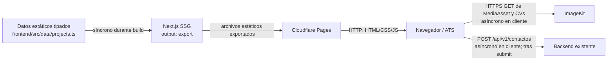

# Portafolio Web de Alberto Zompantzi

## Qué es y para quién

Portafolio bilingüe (español e inglés) dirigido a reclutadores y hiring managers. Presenta perfil y proyectos verificables, permite consultar el CV por idioma y enviar mensajes de contacto. El HTML inicial debe ser legible por sistemas ATS sin JavaScript.

## Diagrama de arquitectura

El flujo sigue la arquitectura v1.0 y la decisión vigente de ADR-0005: los datos se incorporan durante el build; Pages sirve el sitio estático, el navegador consulta los medios y CV desde ImageKit y envía contactos de forma asíncrona.



## Estructura del monorepo

- `frontend/`: interfaz web y configuración pública del endpoint de contacto.
- `backend/`: API de contacto existente (Spring Boot) y su configuración local.
- `docs/`: brief, requisitos, arquitectura, ADR, modelo de datos y contrato OpenAPI.

## Variables de entorno

Usa los archivos de ejemplo como referencia. Copia cada uno a `.env` local en su carpeta y sustituye valores de desarrollo; no publiques esos archivos.

| Archivo | Variable | Uso |
| --- | --- | --- |
| `frontend/.env.example` | `NEXT_PUBLIC_API_BASE_URL` | URL base pública del backend, incorporada al build del frontend. Ejemplo local: `http://localhost:8080`. |
| `backend/.env.example` | `FRONTEND_ORIGIN` | Origen permitido por CORS. Ejemplo local: `http://localhost:3000`. |
| `backend/.env.example` | `SPRING_PROFILES_ACTIVE` | Perfil de Spring; el ejemplo activa `dev`. |
| `backend/.env.example` | `DATABASE_URL` | URL JDBC de PostgreSQL local. |
| `backend/.env.example` | `DATABASE_USER`, `DATABASE_PASSWORD` | Credenciales locales de base de datos; reemplaza el valor de ejemplo y no las compartas. |

ImageKit entrega los activos mediante URLs públicas HTTPS registradas en el catálogo de medios; el frontend no necesita credenciales de ImageKit.

## Cómo correrlo en local

Requisitos: Node.js compatible con las dependencias del frontend, Java 21 y PostgreSQL local. Desde la raíz, en terminales separadas:

```sh
# Terminal 1: API (configura backend/.env según backend/.env.example)
cd backend
./gradlew bootRun

# Terminal 2: frontend (configura frontend/.env según frontend/.env.example)
cd frontend
npm ci
npm run dev
```

En Windows usa `gradlew.bat bootRun`. El frontend actual inicia con Vite en `http://localhost:5173`; configura `FRONTEND_ORIGIN` para ese origen en desarrollo. Los scripts disponibles son `npm run dev`, `npm run build`, `npm run preview` y `npm run lint`. La arquitectura objetivo de despliegue permanece la definida en `docs/architecture/ARCHITECTURE.md` v1.0.

## Documentación

- [Brief del producto](docs/product/BRIEF.md)
- [Requisitos del producto](docs/product/PRD.md)
- [Roadmap](docs/product/ROADMAP.md)
- [Arquitectura v1.0](docs/architecture/ARCHITECTURE.md)
- [Modelo de datos](docs/architecture/DATA_MODEL.md)
- [Flujos](docs/architecture/flows.md)
- [Contrato API (OpenAPI)](docs/api/openapi.yaml)
- [Glosario y MediaPolicy](docs/product/GLOSSARY.md)
- [Riesgos](docs/product/RISKS.md)
- [ADR 0001: monorepo](docs/architecture/adr/0001-monorepo-structure.md)
- [ADR 0002: SSG y hosting](docs/architecture/adr/0002-ssg-framework-and-hosting.md)
- [ADR 0003: medios y CV](docs/architecture/adr/0003-cloud-media-and-cv-storage.md)
- [ADR 0004: CORS y contrato de contacto](docs/architecture/adr/0004-backend-cors-and-contact-contract.md)
- [ADR 0005: entrega de medios y CV con ImageKit](docs/architecture/adr/0005-imagekit-media-and-cv-delivery.md)
- [Inventario de medios publicados](docs/product/MEDIA_ASSETS.md)
- [HU-10: Puerta de Aceptación](docs/product/PRD.md) (checklist previo a merge a `main`, según PRD y arquitectura).
