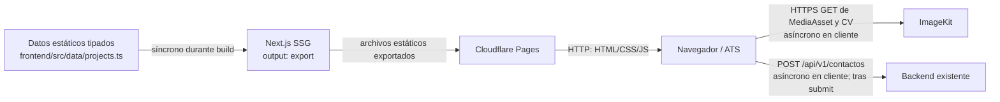

# Arquitectura del Sistema — Portafolio Bilingüe

- **Versión:** v1.0
- **Estado:** Contratos v1.0 congelados; proveedor externo de medios actualizado por ADR-0005 sin cambios de contrato
- **Fecha:** 2026-11-19

## 1. Arquitectura general y flujo de datos

**Decisión.** El proceso de build de Next.js con `output: 'export'` genera las rutas estáticas `/` (Locale `es`) y `/en` (Locale `en`). Cloudflare Pages entrega esos archivos estáticos. El navegador carga los MediaAsset y el PDF del CV por HTTPS desde ImageKit, y cuando el usuario envía el formulario, el cliente llama de forma asíncrona al Backend existente. El build no llama al Backend ni a ImageKit para enviar formularios.

**Por qué.** Esta distribución aplica los ADR aceptados, mantiene el HTML inicial disponible para ATS sin JavaScript y limita las interacciones de contacto a la ejecución del cliente.



Flujos:

- **Estáticos en build:** los datos versionados de proyectos se incorporan al HTML exportado. La generación de `/` y `/en` es local al build; no supone una llamada de red a Backend ni a ImageKit.
- **Entrega estática:** Cloudflare Pages sirve la exportación de Next.js. El HTML debe incluir el perfil y las Ficha técnica en línea completas, visibles sin JavaScript.
- **Asíncronos en cliente:** el navegador obtiene medios y CV desde las URLs HTTPS configuradas en `frontend/src/config/media.ts`; el formulario de contacto envía un POST al Backend. Los estados de carga, éxito y error del formulario pertenecen al cliente.
- **Host final y origen canónico:** `https://albertozompantzi-portfolio.pages.dev` (confirmado por el propietario; D-01 cerrado). Cloudflare Pages sirve las rutas estáticas `/` y `/en` generadas por Next.js `output: 'export'`.

## 2. Ownership por servicio/componente

**Decisión.** Cada responsabilidad de la tabla tiene un único componente dueño. Las comunicaciones entre componentes no transfieren su ownership.

**Por qué.** Esta asignación conserva fronteras explícitas entre contenido y renderizado, servicio de contacto, almacenamiento de medios y entrega web.

| Responsabilidad                                                                                                   | Componente dueño                                               |
| ----------------------------------------------------------------------------------------------------------------- | -------------------------------------------------------------- |
| Datos tipados del catálogo y contenido bilingüe incorporados al build                                             | Frontend SSG/Cliente                                           |
| Generación de las rutas `/` y `/en`, HTML inicial, metadatos y ProgressiveEnhancement en el navegador             | Frontend SSG/Cliente                                           |
| `media.ts`: registro central de URLs de MediaAsset y textos `alt` por Locale; referencia única al CV en español | Frontend SSG/Cliente                                           |
| Gestión del catálogo público de medios y CV en ImageKit                                                        | Alberto Zompantzi / proceso manual (D-03 completado; inventario en `MEDIA_ASSETS.md`) |
| Sanitización de capturas antes de subirlas                                                                        | Alberto Zompantzi / proceso manual (D-02)                      |
| Aplicación de la regla de visibilidad de enlaces                                                                  | Frontend SSG/Cliente, según D-04a/D-04b                        |
| Configuración CORS para el origen desplegado                                                                      | Backend existente (variable `FRONTEND_ORIGIN`, ADR-0004) |
| Ejecución de HU-10 antes de merge a `main`                                                                        | Alberto Zompantzi (proceso manual)                             |
| Validación cliente, HoneypotField, estados localizados y llamada HTTP de contacto                                 | Frontend SSG/Cliente                                           |
| Recepción del DTO `ContactoDTO`, validaciones declaradas en DTO, guardado y respuesta de contacto                 | Backend existente                                              |
| Persistencia de `Contacto` mediante repositorio existente                                                         | Backend existente                                              |
| Almacenamiento y entrega HTTPS de MediaAsset sanitizados y del PDF del CV en español                              | ImageKit                                                       |
| Alojamiento y entrega de los archivos estáticos exportados                                                        | Cloudflare Pages                                               |

**Qué NO hace cada componente**

- **Frontend SSG/Cliente:** no persiste contactos; no valida ni aplica CORS en el servidor; no sube activos a ImageKit durante la navegación; no incluye CMS ni base de datos nueva. HoneypotField no protege contra POST directo al endpoint.
- **Backend existente:** no sirve el sitio estático ni los medios/CV; no define contenido del catálogo; no implementa rate-limiting (excluido); no se atribuye la validación del HoneypotField, que es solo cliente.
- **ImageKit:** entrega medios y aplica las transformaciones configuradas en sus URLs; no genera HTML ni procesa formularios, no administra el catálogo de proyectos ni transforma la respuesta del Backend.
- **Cloudflare Pages:** no ejecuta lógica de servidor de Next.js ni es el Backend de contacto; entrega los archivos estáticos exportados.

## 3. Endpoints externos

**Decisión.** El cliente usará `NEXT_PUBLIC_API_BASE_URL`, incorporada en build por `output: 'export'`, como URL base del Backend y concatenará la ruta relativa documentada abajo. El host de la API de producción no está confirmado. El contrato D-05 se verificó en el código local: el DTO requiere `nombre`, `email` y `mensaje`, acepta `asunto` opcional, y el frontend envía únicamente los tres campos requeridos conforme a ADR-0004. Durante Bloque A, el wildcard CORS debe sustituirse por allowlist externalizada mediante `FRONTEND_ORIGIN`, sin alterar la lógica del controlador ni la entidad; esa configuración aún no está implementada en el backend revisado. El dominio Pages se confirma en ADR-0002.

**Por qué.** Se utiliza el controlador existente en `backend/` sin añadir endpoints ni alterar su lógica. La variable se sustituye durante build; un cambio de backend/origen para Preview o producción requiere configurar el entorno correspondiente y generar un nuevo build. No es un secreto.

### `POST /api/v1/contactos`

- **URL absoluta:** `{NEXT_PUBLIC_API_BASE_URL}/api/v1/contactos` (host de API de producción aún por confirmar).
- **Headers de petición:** `Content-Type: application/json`. En petición cross-origin el navegador envía el Origin de la página; el origen de producción confirmado es `https://albertozompantzi-portfolio.pages.dev`. Su configuración en `FRONTEND_ORIGIN` sigue pendiente de implementación en Bloque A.
- **CORS y decisión vinculante (ADR-0004):** el código local inspeccionado declara `@CrossOrigin(origins = "*")` y `application.yml` no muestra una variable CORS. Durante Bloque A se sustituirá el wildcard por configuración externalizada con `FRONTEND_ORIGIN`; el backend aceptará únicamente el origen configurado y rechazará los no listados. Configurar `FRONTEND_ORIGIN` en el entorno del backend antes de probar producción es requisito operativo; HU-10 punto 8 valida envío y CORS contra el dominio final.
- **Request JSON** del frontend (payload `ContactSubmission`; `ContactoDTO` también acepta `asunto` opcional, que el frontend omite):

```json
{
  "nombre": "Alex Ejemplo",
  "email": "alex@example.test",
  "mensaje": "Hola, me gustaría ponerme en contacto."
}
```

- **Éxito:** `201 Created`; el controlador devuelve la entidad `Contacto` guardada. Según `Contacto.java`, la serialización incluye sus campos, incluso `asunto` como `null` cuando no se proporciona; también incluye `id` y `fechaRegistro` (`LocalDateTime`). Ejemplo ilustrativo:

```json
{
  "id": 1,
  "nombre": "Alex Ejemplo",
  "email": "alex@example.test",
  "asunto": null,
  "mensaje": "Hola, me gustaría ponerme en contacto.",
  "fechaRegistro": "2026-11-19T12:30:00"
}
```

- **Validaciones observadas en código local** (`backend/src/main/java/com/alberto/portfolio/dtos/ContactoDTO.java`): `nombre`, `email` y `mensaje` tienen `@NotBlank`; `email` también tiene `@Email`; `asunto` no tiene restricciones Bean Validation ni longitud máxima declarada. `@NotBlank` rechaza valores nulos, vacíos o compuestos solo por espacios. Se verificó el mapeo de `400 Bad Request` para JSON mal formado o fallos de validación; el `201 Created` devuelve la entidad persistida. `415 Unsupported Media Type` aplica a tipos de contenido incompatibles y fallos no controlados producen `500 Internal Server Error`. El backend no define `@ControllerAdvice`; estos errores usan el manejo predeterminado de Spring Boot. La documentación se verificó contra el código fuente local; no se realizó una llamada a una instancia en ejecución.
- **CORS observado:** `ContactoController` declara `@CrossOrigin(origins = "*")`; no se encontró configuración `FRONTEND_ORIGIN` en `application.yml`. La allowlist de ADR-0004 es una decisión pendiente de implementación, no el comportamiento actual. Este ticket no modifica backend.

## 4. Contratos internos y fronteras

**Decisión.** Los datos estáticos se tipan y resuelven en build; `media.ts` relaciona MediaAsset y CV con URLs públicas de ImageKit; el formulario transforma los campos definidos por el producto en el payload de `ContactSubmission`, con esquema `{ nombre: string, email: string, mensaje: string }` según ADR-0004. Este payload frontend es un subconjunto del DTO: el backend también acepta `asunto` opcional. `ContactoDTO` local se describe en la sección 3. La forma definitiva del contenido de proyectos y la implementación de `visualFallback` siguen pendientes donde GLOSSARY las marca como propuesta.

**Por qué.** Los contratos hacen explícito qué cruza cada frontera, sin introducir CMS, una base de datos nueva ni capacidades no presentes.

### Datos estáticos → Build SSG

Esquema conceptual `Project` del Glosario: `slug`, `visibilityRule`, `repoUrl`, `liveUrl`, `stackTags`, `roleTags`, `mediaId`, `locales`. Cada Locale contiene `title`, `summary`, `problem`, `solution`, `stackDescription`, `roleDescription`, y los campos opcionales `architecture`, `flowOrDiagram`, `technicalChallenges`, `results`. Según GLOSSARY, `architecture` es obligatoria si el proyecto no publica repositorio ni URL de producción; verificarlo en el tipo o prueba de datos.

Ejemplo JSON válido con campos según el esquema conceptual; las taxonomías siguen PENDIENTE; `visibilityRule` deriva su comportamiento directamente de las URLs y las confirmaciones D-04a/D-04b:

```json
{
  "slug": "ejemplo",
  "visibilityRule": "solo arquitectura/flujo sin enlaces externos",
  "repoUrl": null,
  "liveUrl": null,
  "stackTags": [],
  "roleTags": [],
  "mediaId": null,
  "locales": {
    "es": {
      "title": "Ejemplo",
      "summary": "Resumen del proyecto.",
      "problem": "Problema descrito.",
      "solution": "Solución descrita.",
      "stackDescription": "Stack documentado.",
      "roleDescription": "Rol documentado.",
      "architecture": "Arquitectura documentada de ejemplo.",
      "flowOrDiagram": null,
      "technicalChallenges": null,
      "results": null
    },
    "en": {
      "title": "Example",
      "summary": "Project summary.",
      "problem": "Problem described.",
      "solution": "Solution described.",
      "stackDescription": "Documented stack.",
      "roleDescription": "Documented role.",
      "architecture": "Example documented architecture.",
      "flowOrDiagram": null,
      "technicalChallenges": null,
      "results": null
    }
  }
}
```

Este ejemplo ilustra estructura y no afirma un proyecto real ni valores aprobados. `visibilityRule` es una regla de presentación: cada botón/enlace solo se renderiza si su URL correspondiente no es `null`, sujeto a las confirmaciones D-04a/D-04b.

### Frontend → ImageKit vía `media.ts`

El Glosario define conceptualmente `MediaAsset` como recurso visual con `id`, `url`, `alt` por Locale y `visualFallback`. El PDF de CV no es `MediaAsset`; su registro es una única referencia URL para el CV en español con su texto/`aria-label`. Solo la ruta `es` (`/`) muestra el enlace; `/en` no ofrece opción de CV. Las URLs verificadas se registran en `docs/product/MEDIA_ASSETS.md`; la implementación de fallback sigue PENDIENTE.

```json
{
  "id": "profile",
  "url": "https://ik.imagekit.io/<imagekit_id>/Portfolio/profile.webp",
  "alt": {
    "es": "Retrato de perfil",
    "en": "Profile portrait"
  },
  "visualFallback": {}
}
```

URL ilustrativa: el endpoint y el ID de ImageKit deben corresponder a la cuenta elegida y las rutas al inventario aprobado; no se incluyen claves privadas. `visualFallback` es obligatorio según GLOSSARY; su tipo/configuración concreta permanece PENDIENTE. Navegación: el cliente realiza GET HTTPS al recurso; no existe aquí un endpoint de escritura/subida definido para el navegador.

### Frontend → Backend existente

Frontera `ContactSubmission` según ADR-0004: `payload` contiene únicamente `nombre`, `email` y `mensaje`; `honeypot` y `locale` son datos solo cliente y no se envían al Backend. El campo opcional `asunto` se omite.

```json
{
  "nombre": "Alex Ejemplo",
  "email": "alex@example.test",
  "mensaje": "Hola, me gustaría ponerme en contacto."
}
```

La respuesta de éxito corresponde a la entidad `Contacto` descrita en la sección 3. El POST es asíncrono tras la acción del usuario. El backend no recibe `honeypot` ni `locale`; el frontend omite `asunto` conforme a ADR-0004.

### Puntos de coherencia de ownership

- Cloudflare Pages es dueño de entregar archivos estáticos; Frontend SSG/Cliente es dueño de generarlos.
- ImageKit es dueño del almacenamiento y la entrega pública de objetos; Frontend SSG/Cliente es dueño del registro `media.ts` y de solicitar los objetos.
- Backend existente es dueño de validar el DTO declarado y persistir el contacto; Frontend SSG/Cliente es dueño de la validación de formato cliente, del HoneypotField y de presentar estados de interacción.

## 5. Respuesta canónica y reglas de campos derivados

**Decisión.** La fuente canónica del catálogo es `frontend/src/data/projects.ts`: cada `Project` contiene sus datos compartidos y `locales` con los contenidos `es` y `en` de `LocalizedProjectContent`. La fuente canónica de activos es `frontend/src/config/media.ts`, que registra cada `MediaAsset`. Datos de perfil/experiencia y diccionarios ES/EN deberán tener módulos canónicos tipados compartidos; ubicación e interfaz TypeScript común para paridad estructural quedan PENDIENTE de concretar en frontend. El estado del formulario es efímero y reside en el cliente; `ContactSubmission` usa `payload: { nombre, email, mensaje }`, además de `honeypot` y `locale` solo en cliente. No se duplican en estado persistido ni en copias derivadas los valores que puedan calcularse desde estas fuentes.

**Por qué.** Esta organización sigue los contratos conceptuales del Glosario, conserva el contenido bilingüe disponible para SSG y evita que datos derivados diverjan de la configuración canónica.

| Valor o comportamiento              | Fuente canónica                                                | Regla de derivación                                                                                                                                                                                                                                                                                                                                                                                                                                                                                            | Persistencia / duplicación                                                                                                                                                                                                                                                                                                 |
| ----------------------------------- | -------------------------------------------------------------- | -------------------------------------------------------------------------------------------------------------------------------------------------------------------------------------------------------------------------------------------------------------------------------------------------------------------------------------------------------------------------------------------------------------------------------------------------------------------------------------------------------------- | -------------------------------------------------------------------------------------------------------------------------------------------------------------------------------------------------------------------------------------------------------------------------------------------------------------------------- |
| Contenido mostrado del proyecto     | `Project.locales[Locale]`                                      | Resolver el contenido por el `Locale` de la ruta (`/` → `es`, `/en` → `en`) durante build/renderizado.                                                                                                                                                                                                                                                                                                                                                                                                         | No crear una copia por idioma fuera de `locales`.                                                                                                                                                                                                                                                                          |
| Visibilidad de enlaces del proyecto | `visibilityRule`, `repoUrl`, `liveUrl` y matriz de D-04a/D-04b | `repoUrl == null` o `liveUrl == null` impide renderizar su enlace correspondiente; la regla de publicación no puede habilitar una URL ausente. Las confirmaciones de visibilidad de repositorios siguen pendientes en D-04a/D-04b.                                                                                                                                                                                                                                                                                                  | `visibilityRule` es una regla de presentación derivada de la nulidad/presencia de `repoUrl` y `liveUrl` y de las confirmaciones D-04a/D-04b; si una URL es `null`, se suprime su botón/enlace en UI. |
| Texto alternativo de activo         | `MediaAsset.alt`                                               | Seleccionar `alt[Locale]` según ruta.                                                                                                                                                                                                                                                                                                                                                                                                                                                                          | No duplicar el `alt` localizado en cada proyecto; referenciar el activo por `mediaId`.                                                                                                                                                                                                                                     |
| Fallback visual                     | `MediaAsset.visualFallback`                                    | `visualFallback` es obligatorio según GLOSSARY; activarlo solo en cliente hidratado si falla la carga, según HU-01. Implementación PENDIENTE.                                                                                                                                                                                                                                                                                                                                                                  | No persistir el resultado del error ni duplicar el fallback en datos de proyecto.                                                                                                                                                                                                                                          |
| PDF de CV                           | Referencia única en `media.ts`                                  | Mostrar el enlace al CV ES solo en `/`; `/en` no ofrece control ni enlace de descarga de CV. URL y texto seleccionable verificados en D-06.                                                                                                                                                                                                                                                                                                                                                                    | No derivar una URL de CV inglés ni mostrar una descarga en `/en`.                                                                                                                                                                                                                                                         |
| Estado/valores del formulario       | Campos del formulario y `ContactFormStatus`                    | Limpiar valores tras `SUCCESS`; conservarlos en `ERROR_VALIDATION` y `ERROR_NETWORK`. `SUCCESS` es final; un nuevo envío requiere recarga o reinicio explícito a `IDLE`.                                                                                                                                                                                                                                                                                                                                       | No guardar datos personales en `localStorage`, `sessionStorage`, cookies ni consola. No incluir `honeypot` o `locale` en el payload HTTP.                                                                                                                                                                                  |
| Modo del fondo                      | Estado táctil, `prefers-reduced-motion` y errores del script   | Tras `HYDRATED`, `STATIC_TOUCH` tiene prioridad sobre `STATIC_REDUCED_MOTION`, con dispositivo táctil detectado mediante `matchMedia('(pointer: coarse)')` sobre el puntero primario (un equipo táctil con ratón puede clasificarse como no táctil); si no aplica ninguno, pasar a `INTERACTIVE_POINTER` e iniciar el efecto. Error de inicialización o actualización en ese estado lleva a `STATIC_FALLBACK`. En el MVP no se reevalúa `prefers-reduced-motion` en runtime; se evalúa al entrar al recorrido. | No persistir el modo: evaluarlo en cada carga/hidratación y no reevaluar preferencias en runtime durante el MVP. D-07d fija >= 60 FPS en escritorio 60 Hz y LCP <= 2.5 s al percentil 75 por perfil móvil/escritorio.                                                                                                                                                               |

## 6. Máquina de estados

**Decisión.** Las transiciones válidas son las que aparecen en las siguientes tablas y en los tres recorridos correspondientes de [flows.md](flows.md): Recorrido A en el diagrama principal (sección 1), Recorrido B en la máquina del formulario (sección 2) y Recorrido C en el diagrama principal (sección 1). La secuencia de servicios de la sección 3 de `flows.md` complementa el efecto de red del formulario.

**Por qué.** Las tablas fijan guardas y efectos observables para implementar y revisar las mismas rutas descritas por los diagramas fuente, sin introducir estados nuevos.

### Recorrido A: Carga e hidratación de página

| Estado actual | Evento / Condición                                  | Estado siguiente            | Efecto observable                                                                                       |
| ------------- | --------------------------------------------------- | --------------------------- | ------------------------------------------------------------------------------------------------------- |
| Inicial       | Solicitud de `/` o `/en` recibe HTML prerenderizado | `SSR_STATIC`                | HTML completo con idioma y contenido inicial; medios se solicitan aparte.                               |
| `SSR_STATIC`  | JavaScript deshabilitado                            | `SSR_STATIC` (final válido) | Contenido estático íntegro permanece visible y legible.                                                 |
| `SSR_STATIC`  | JavaScript activo; hidratación termina sin errores  | `HYDRATED`                  | Interacciones de mejora progresiva quedan habilitadas; se habilita evaluación del fondo.                |
| `SSR_STATIC`  | JavaScript activo; ocurre error de hidratación      | `HYDRATION_FAILED`          | DOM inicial permanece íntegro y visible; botón de submit sigue deshabilitado y el formulario no navega. |

### Recorrido B: Formulario de contacto

| Estado actual      | Evento / Condición                                            | Estado siguiente   | Efecto observable                                                                                                          |
| ------------------ | ------------------------------------------------------------- | ------------------ | -------------------------------------------------------------------------------------------------------------------------- |
| Inicial            | Render inicial del formulario                                 | `IDLE`             | Formulario listo y nota de privacidad localizada visible.                                                                  |
| `IDLE`             | Evento `submit`                                               | `VALIDATING`       | Cliente revisa campos y `HoneypotField` antes de red.                                                                      |
| `VALIDATING`       | Honeypot contiene texto                                       | `DROPPED_HONEYPOT` | Descarta silenciosamente; cero petición HTTP y ningún error mostrado.                                                      |
| `VALIDATING`       | Campos que no satisfacen el criterio cliente definido en §9.  | `ERROR_VALIDATION` | Detiene envío y muestra error localizado; no inicia petición.                                                              |
| `VALIDATING`       | Validación cliente correcta y honeypot vacío                  | `SUBMITTING`       | Muestra carga localizada y envía el payload documentado a la URL de entorno.                                               |
| `ERROR_VALIDATION` | Usuario corrige los valores y vuelve a enviar                 | `VALIDATING`       | Revalida antes de cualquier petición.                                                                                      |
| `SUBMITTING`       | Backend acepta el envío (respuesta exitosa y origen aceptado) | `SUCCESS`          | Detiene carga y muestra confirmación localizada.                                                                           |
| `SUBMITTING`       | Error de red, rechazo CORS, timeout o respuesta HTTP de error | `ERROR_NETWORK`    | Detiene carga y muestra error localizado.                                                                                  |
| `ERROR_NETWORK`    | Usuario reintenta                                             | `VALIDATING`       | Revalida antes de volver a solicitar.                                                                                      |
| `SUBMITTING`       | Nuevo evento `submit` (doble clic o Enter)                    | `SUBMITTING`       | Ignorar; botón deshabilitado; no iniciar otra petición (prueba de una sola petición propuesta; ver solicitudes de cambio). |

### Recorrido C: Fondo reactivo

| Estado actual         | Evento / Condición                                                             | Estado siguiente        | Efecto observable                                                                                                      |
| --------------------- | ------------------------------------------------------------------------------ | ----------------------- | ---------------------------------------------------------------------------------------------------------------------- |
| `HYDRATED`            | `matchMedia('(pointer: coarse)').matches`                                      | `STATIC_TOUCH`          | Sin elemento animado ni listeners de puntero.                                                                          |
| `HYDRATED`            | `(pointer: coarse)` no coincide y `prefers-reduced-motion: reduce`             | `STATIC_REDUCED_MOTION` | Sin elemento animado ni listeners de puntero.                                                                          |
| `HYDRATED`            | `(pointer: coarse)` no coincide y `prefers-reduced-motion: reduce` no coincide | `INTERACTIVE_POINTER`   | Se inicia el efecto y el fondo sigue el puntero; solo se animan `transform`/`opacity`, bajo el umbral D-07d de >= 60 FPS en escritorio 60 Hz. |
| `INTERACTIVE_POINTER` | Error al inicializar o actualizar el efecto                                    | `STATIC_FALLBACK`       | Limpia el efecto y listeners; interfaz queda estática.                                                                 |

## 7. Enums del dominio y tipos internos

**Decisión.** Los enums del dominio usan exclusivamente los valores del GLOSSARY, con su grafía exacta. Los tipos internos listados aparte no son enums de dominio. Los componentes responsables emiten las transiciones descritas en la sección 6.

**Por qué.** Un conjunto cerrado evita estados implícitos y mantiene la terminología del dominio alineada con GLOSSARY.md y flows.md.

| Enum                                       | Valor permitido         | Significado                                                                                 | Componente que lo origina                                  |
| ------------------------------------------ | ----------------------- | ------------------------------------------------------------------------------------------- | ---------------------------------------------------------- |
| `Locale`                                   | `es`                    | Español, ruta `/` y `x-default`.                                                            | Resolutor de ruta/SSG.                                     |
| `Locale`                                   | `en`                    | Inglés, ruta `/en`.                                                                         | Resolutor de ruta/SSG.                                     |
| `HydrationStatus`                          | `SSR_STATIC`            | HTML prerenderizado disponible antes de JavaScript; estado válido si JS está deshabilitado. | Frontend SSG/Cliente.                                      |
| `HydrationStatus`                          | `HYDRATED`              | Scripts cliente ejecutados sin errores; habilita interacciones y evaluación del fondo.      | Frontend SSG/Cliente.                                      |
| `HydrationStatus`                          | `HYDRATION_FAILED`      | Falló JavaScript; DOM inicial sigue íntegro y visible.                                      | Frontend SSG/Cliente al capturar fallo de hidratación.     |
| `ContactFormStatus`                        | `IDLE`                  | Formulario inicial, nota de privacidad visible y listo.                                     | Renderizado del formulario en Frontend SSG/Cliente.        |
| `ContactFormStatus`                        | `VALIDATING`            | Revisión cliente de formato y honeypot.                                                     | Componente del formulario al recibir `submit` o reintento. |
| `ContactFormStatus`                        | `DROPPED_HONEYPOT`      | Descarte cliente sin HTTP.                                                                  | Componente del formulario si honeypot contiene texto.      |
| `ContactFormStatus`                        | `SUBMITTING`            | Petición HTTP en curso, con espera de arranque en frío.                                     | Componente del formulario tras validar.                    |
| `ContactFormStatus`                        | `SUCCESS`               | Backend aceptó; confirmación localizada visible.                                            | Componente del formulario tras respuesta exitosa.          |
| `ContactFormStatus`                        | `ERROR_VALIDATION`      | Error de validación cliente; criterio único en §9.                                          | Validador cliente del formulario.                          |
| `ContactFormStatus`                        | `ERROR_NETWORK`         | Fallo de red, rechazo CORS, timeout o respuesta HTTP de error.                              | Componente del formulario al observar el fallo.            |
| Tipo interno de error (no enum de dominio) | `HTTP_ERROR`            | Respuesta HTTP no exitosa.                                                                  | Adaptador HTTP del Frontend.                               |
| Tipo interno de error (no enum de dominio) | `NETWORK_ERROR`         | Fallo de red sin respuesta utilizable.                                                      | Adaptador HTTP del Frontend.                               |
| Tipo interno de error (no enum de dominio) | `TIMEOUT`               | Venció el timeout configurado.                                                              | Adaptador HTTP del Frontend.                               |
| Tipo interno de error (no enum de dominio) | `CORS_OR_NETWORK_ERROR` | Fallo indistinguible de CORS/red en navegador.                                              | Adaptador HTTP del Frontend.                               |
| `BackgroundMode`                           | `INTERACTIVE_POINTER`   | Seguimiento del cursor en escritorio, con `transform`/`opacity`; >= 60 FPS en pantalla de 60 Hz conforme a D-07d.  | Evaluador del fondo en cliente tras `HYDRATED`.            |
| `BackgroundMode`                           | `STATIC_REDUCED_MOTION` | Fondo desactivado por `prefers-reduced-motion: reduce`, sin elemento animado ni listeners.  | Evaluador del fondo en cliente.                            |
| `BackgroundMode`                           | `STATIC_TOUCH`          | Fondo desactivado en dispositivo táctil, sin elemento animado ni listeners.                 | Evaluador del fondo en cliente.                            |
| `BackgroundMode`                           | `STATIC_FALLBACK`       | Fondo desactivado tras error de inicialización o ejecución.                                 | Controlador del fondo al capturar error.                   |

## 8. Reglas de negocio configurables

**Decisión.** Solo se configura mediante variables de entorno lo documentado en la tabla. `NEXT_PUBLIC_API_BASE_URL` se incorpora en build. ADR-0004 resuelve CORS como configuración externalizada `FRONTEND_ORIGIN` durante Bloque A, sin cambios de lógica de negocio; se admite solo ese origen y se rechazan los no listados. D-07c queda acordado: Devicon `v2.16.0` (MIT) para iconos de marcas de tecnologías y máximo de `15 KB` por SVG local. D-07d fija `>= 60 FPS` en escritorio 60 Hz y LCP `<= 2.5 s` al percentil 75 móvil/escritorio, con perfiles responsive sin modelo específico.

**Por qué.** Se conserva la configuración ya documentada y se evita presentar como contrato existente una variable que no aparece en el backend inspeccionado.

| Parámetro                                                                                        | Nombre de variable                                                             | Componente                            | Valor por defecto / SUPUESTO                                                                                                                                                               | Exposición                                                                                              |
| ------------------------------------------------------------------------------------------------ | ------------------------------------------------------------------------------ | ------------------------------------- | ------------------------------------------------------------------------------------------------------------------------------------------------------------------------------------------ | ------------------------------------------------------------------------------------------------------- |
| URL base del endpoint de contacto (rutas de sección 3 concatenadas)                              | `NEXT_PUBLIC_API_BASE_URL`                                                     | Frontend SSG/Cliente                  | Sin valor por defecto confirmado; debe configurarse por entorno.                                                                                                                           | Público: requerido por el navegador, no es secreto.                                                     |
| Dominio/origen permitido para CORS                                                               | `FRONTEND_ORIGIN`                                            | Backend existente                     | Se configura antes de probar producción; no se admite wildcard y se rechazan otros orígenes.                  | Privado como configuración de servidor (el origen no es secreto); nunca se expone como secreto cliente. |
| Timeout de petición del formulario para ColdStart                                                | Mecanismo/nombre de variable PENDIENTE                                         | Frontend SSG/Cliente                  | **SUPUESTO PRD:** cota mínima `>= 35 s`. Valor de implementación PENDIENTE. Prueba de vencimiento propuesta como prueba E2E/unitaria; aún no forma parte de las 9 comprobaciones de HU-10. | Público si se incorpora al bundle cliente; no contiene secreto.                                         |
| Fuente de iconos y umbral de peso por SVG de marquesina (D-07c)                                  | No aplica; verificar versión/fuente y tamaño en build/puerta de aceptación      | Frontend/build y puerta de aceptación | **Aprobado:** Devicon `v2.16.0` (MIT) para marcas de tecnologías y `<= 15 KB` por archivo SVG local. Las marcas pertenecen a sus titulares.                                                    | Público/no secreto; aplica a archivos y verificación de build.                                           |
| Parámetros del fondo reactivo (D-07d), incluidos umbrales de FPS/LCP y dispositivo de referencia | No aplica; son criterios de aceptación, no parámetros de entorno | Frontend SSG/Cliente | `>= 60 FPS` en escritorio 60 Hz; LCP `<= 2.5 s` al percentil 75 por perfil móvil/escritorio. Referencia responsive: 360 × 800, 768 × 1024 y 1280 × 800 en Chromium estable; puntero fino/60 Hz para FPS. | Público/no secreto; se validan en aceptación. |

## 9. Flujo del formulario de contacto e invariantes

**Decisión.** El formulario conserva el flujo `IDLE → VALIDATING → SUBMITTING → SUCCESS` o `ERROR_NETWORK`, con las rutas de descarte y validación de la sección 6. Invariante de privacidad: ningún dato del formulario aparece en la URL. El HTML usa `<form method="post">` sin `action`, submit deshabilitado en SSR y habilitado solo tras hidratación; `<noscript>` muestra el mensaje localizado `contact.noscript`. Si ocurre `HYDRATION_FAILED`, el submit permanece deshabilitado. El método POST impide que cualquier envío nativo serialice los datos en query string. Antes de la petición cliente valida los campos según el criterio único de abajo y comprueba `HoneypotField`. El payload HTTP contiene únicamente `{ "nombre": string, "email": string, "mensaje": string }` según ADR-0004; `asunto` se omite, y `honeypot` y `locale` permanecen solo en cliente.

**Por qué.** El método POST, la ausencia de `action` y el submit deshabilitado en SSR mantienen los datos fuera de la URL; el honeypot descarta automatizaciones antes de enviar.

Invariantes obligatorios:

- **Criterio único de validación cliente:** rechazar `nombre`/`mensaje` vacíos o solo espacios, y `email` vacío/solo espacios o que no pase `type="email"` con `required` y `checkValidity()`. El chequeo cliente es una aproximación y no garantiza equivalencia con `@Email`; un HTTP 400 residual tras pasar cliente se acepta y muestra `contact.error.generic`. Los límites de longitud y la política de trim siguen pendientes; `asunto` no forma parte del payload del frontend.

- Si `honeypot` contiene texto, se transita a `DROPPED_HONEYPOT` sin petición HTTP saliente ni mensaje de error.
- La nota de privacidad de una línea permanece visible junto al formulario en `/` y `/en`, en el idioma activo, e indica que los datos se usan exclusivamente para responder el contacto.
- La validación de cliente ocurre antes de invocar red. No sustituye las validaciones del backend.
- Cero datos personales ingresados en el formulario se escriben en `console.*`, `localStorage`, `sessionStorage` o cookies.
- El idioma (`locale`) y el campo trampa no se envían al backend. No se agregan campos al payload HTTP aprobado `{ nombre, email, mensaje }`; `asunto` se omite conforme a ADR-0004.
- El endpoint se lee de `NEXT_PUBLIC_API_BASE_URL` y no se presenta como enlace visible en la UI.

El mapeo de respuestas HTTP se define en una única tabla canónica en la sección 14. Las transiciones del formulario y sus efectos de UI se definen en la sección 6.

## 10. Modelo de datos mínimo

**Decisión.** El modelo de contenido persistido consiste únicamente en módulos TypeScript estáticos versionados dentro de `frontend/`. `frontend/src/data/projects.ts` mantiene el catálogo de proyectos con campos compartidos y contenido localizado `es`/`en`, conforme al contrato conceptual de `Project` y `LocalizedProjectContent` descrito en las secciones 4 y 5. `frontend/src/config/media.ts` es el catálogo central de `MediaAsset`, con identificador, URL externa, textos alternativos por Locale y referencia de fallback visual. Perfil, experiencia y formación residen en módulos canónicos de datos tipados del frontend; los textos de interfaz en diccionarios `es`/`en` con tipo compartido para exigir paridad estructural. Las rutas concretas de los módulos siguen PENDIENTE de organización del frontend; no se añade almacén de datos.

No existe base de datos propia del portafolio ni persistencia de envíos en frontend. El formulario conserva sus valores y estado solo en memoria durante la interacción y envía al Backend existente el payload `{ nombre, email, mensaje }` descrito en sección 3 y fijado por ADR-0004. No se guardan datos personales en almacenamiento del navegador. En build se derivan las rutas `/` y `/en`, HTML, metadatos SEO, textos según Locale y el enlace al CV español solo en `/`. En cliente/runtime se derivan el estado del formulario, la selección de contenido por ruta, filtros y presentación interactiva, `alt` por Locale, modo del fondo reactivo y fallbacks ante error de carga. Estos derivados no son fuentes canónicas ni se persisten.

**Por qué.** Los módulos tipados constituyen una fuente revisable en Git y alimentan la exportación estática bilingüe del ADR-0002. Mantener efímero el formulario satisface los requisitos de privacidad y evita introducir un CMS, una base de datos o almacenamiento adicional.

## 11. Entrega externa de medios y convención de rutas

**Decisión.** ImageKit es el proveedor único de almacenamiento y entrega HTTPS para imágenes sanitizadas, identidad visual, imágenes Open Graph y CV, según ADR-0005. Los activos se organizan en la carpeta `Portfolio/` de la Media Library. Las URLs concretas y los MIME verificados se registran en `docs/product/MEDIA_ASSETS.md`; no se guardan credenciales de ImageKit en el frontend ni en Git.

| Uso                            | Ruta recomendada en ImageKit                 | Content-Type esperado                        |
| ------------------------------ | -------------------------------------------- | -------------------------------------------- |
| Captura sanitizada de proyecto | `Portfolio/<asset-id>.<ext>`                 | MIME verificado de la URL final              |
| CV en español                  | `Portfolio/<nombre>.pdf`                      | `application/pdf`                             |
| Foto de perfil                 | `Portfolio/<nombre>.<ext>`                    | MIME verificado de la URL final              |
| Logo                           | `Portfolio/<nombre>.<ext>`                    | MIME verificado de la URL final              |
| Open Graph                     | `Portfolio/<nombre>.<ext>`                    | MIME verificado de la URL final              |

El umbral de SVG local es `<= 15 KB` conforme a D-07c y se verifica en la puerta HU-10/build. La fuente aprobada para marcas tecnológicas es Devicon `v2.16.0` (MIT), respetando las políticas de marca de sus titulares. Las capturas deben estar sanitizadas antes de subirlas (D-03); los originales crudos permanecen fuera de Git y no se publican. `media.ts` registra las URLs públicas HTTPS verificadas, los textos `alt` ES/EN y la referencia al fallback visual. ImageKit puede optimizar o convertir el formato de salida; cuando un requisito fija MIME, se fuerza el formato en la URL y se vuelve a verificar la respuesta HTTP. No se asume que la extensión del nombre por sí sola determine el `Content-Type`. Las URLs de las capturas sanitizadas, el logo, la foto de perfil y el CV español responden HTTP 200 con MIME documentado en el inventario. D-03 y D-06 están completados; el umbral SVG sigue sujeto a D-07c.

MediaPolicy exige cero binarios no exentos en Git y cero archivos en `frontend/public/imagenes/`; los medios se solicitan desde ImageKit y los únicos binarios exentos son los expresamente permitidos por dicha política. La Puerta de Aceptación HU-10 comprueba `git ls-files` y `git log` contra esta política.

**Por qué.** ImageKit permite cargar activos desde su Media Library y servirlos mediante URLs HTTPS con optimización bajo demanda sin acoplarlos al build ni inflar el historial del monorepo. Las URLs se mantienen centralizadas en `media.ts`; cualquier cambio de archivo, transformación o URL debe volver a pasar la comprobación de disponibilidad y MIME.

## 12. Manejo de errores, timeouts, reintentos y fallbacks

**Decisión.** Los fallos de red no deben ocultar el contenido HTML estático. El formulario usa el timeout cliente requerido por PRD de al menos 35 s (`SUPUESTO` documentado en PRD) para tolerar el arranque en frío. No se reintenta automáticamente un POST. Un reintento manual desde `ERROR_NETWORK` puede duplicar un contacto si el servidor guardó el envío y se perdió la respuesta; riesgo aceptado del MVP conforme al riesgo secundario de RISKS.md. No hay idempotencia documentada.

| Escenario de fallo                               | Detección                                                                                                                                             | Timeout / Reintentos                                                                                                           | Fallback garantizado                                                                                                                                                                            |
| ------------------------------------------------ | ----------------------------------------------------------------------------------------------------------------------------------------------------- | ------------------------------------------------------------------------------------------------------------------------------ | ----------------------------------------------------------------------------------------------------------------------------------------------------------------------------------------------- |
| Envío sin JavaScript o `HYDRATION_FAILED`        | Prueba del HTML inicial confirma `method="post"`, ausencia de `action` y botón submit deshabilitado; `<noscript>` expone `contact.noscript`.          | Sin envío con JavaScript deshabilitado; cualquier submit habilitado usa método POST y nunca añade datos a la URL.              | Se conserva la página y los datos no se filtran por URL.                                                                                                                                        |
| Cold start o caída de `backend/`                 | El POST no completa antes del timeout, falla la red o devuelve HTTP de error.                                                                         | Timeout cliente `>= 35 s` (`SUPUESTO` del PRD). Sin reintento automático; el usuario puede reintentar.                         | Termina el estado de carga, muestra error localizado y conserva la página y el HTML estático. La caída del Backend no afecta perfil, catálogo ni CV enlazados.                                  |
| Rechazo CORS                                     | El navegador impide que JavaScript lea la respuesta; se observa como fallo de red en cliente. No siempre permite distinguirlo de otros fallos de red. | Se aplica el timeout del POST; no hay reintento automático. Reintento manual tras corregir el origen en backend/configuración. | Estado `ERROR_NETWORK` y mensaje localizado genérico; el contenido y los enlaces estáticos permanecen disponibles.                                                                              |
| Error HTTP/red al cargar imagen de ImageKit (MediaAsset) | Evento `error` del recurso o fallo HTTP observado por navegador.                                                                               | No se bloquea el renderizado esperando la imagen. No se define reintento de descarga en aplicación.                            | El HTML conserva texto y `alt`; con cliente hidratado se activa el `visualFallback` configurado. Si no hay fallback disponible, el contenido textual permanece legible y no se oculta la ficha. |
| PDF de CV ImageKit no disponible (404/403)        | Comprobación HTTP en HU-10 puntos 2/5, antes de merge; no es verificación runtime.                                                                    | Sin fallback runtime ni reintento definido; riesgo de indisponibilidad en nube aceptado.                                       | El enlace es estático y puede quedar roto hasta la siguiente comprobación/corrección. HU-10 verifica HTTP 200 antes de merge.                                                                   |
| `HYDRATION_FAILED`                               | Excepción de hidratación JavaScript tras recibir HTML estático.                                                                                       | Sin reintento automático de hidratación.                                                                                       | DOM inicial íntegro y visible; filtros/modal y otras mejoras cliente pueden no estar disponibles. El recorrido estático con detalle en línea sigue legible.                                     |
| Excepción del fondo reactivo → `STATIC_FALLBACK` | Error al inicializar o actualizar el efecto.                                                                                                          | Sin reintento; se detiene el efecto y se limpian sus listeners.                                                                | Fondo estático, sin elemento animado ni listeners de puntero activos; contenido y navegación permanecen íntegros.                                                                               |

**Por qué.** La estrategia conserva los invariantes de disponibilidad del PRD, no oculta fallos de contacto y evita que dependencias opcionales de cliente se conviertan en condición para leer el portafolio.

## 13. Responsabilidades por componente y orden de construcción

**Decisión.** La construcción sigue el Walking Skeleton del ROADMAP: primero monorepo y medios, luego exportación bilingüe mínima con Tzompcomer, integración de contacto, despliegue de humo, expansión y Puerta de Aceptación HU-10 antes de cada merge a `main`.

| Componente                        | Stack / Herramientas                               | Entregables técnicos                                                                                                                                                                                                             | Restricciones                                                                                                                              |
| --------------------------------- | -------------------------------------------------- | -------------------------------------------------------------------------------------------------------------------------------------------------------------------------------------------------------------------------------- | ------------------------------------------------------------------------------------------------------------------------------------------ |
| Frontend SSG/Cliente              | Next.js, TypeScript, React; `output: 'export'`     | Rutas `/` (ES) y `/en` (EN); HTML prerenderizado con contenido y fichas en línea; módulos tipados de contenido; navegación entre idiomas; mejora progresiva; formulario conectado al Backend; selección de CV; manejo de fallos. | Sin servidor SSR dinámico ni APIs de servidor Next.js; sin CMS ni persistencia propia. HTML y fichas deben seguir legibles sin JavaScript. |
| Backend existente                 | Servicio y herramientas ya presentes en `backend/` | Recibir el DTO de contacto, validarlo y persistirlo según el contrato existente; configuración CORS para origen desplegado según decisión D-05.                                                                                  | No modificar lógica de negocio ni añadir rate-limiting para el MVP; no servir el frontend ni medios.                                       |
| ImageKit                          | Media Library y CDN con URLs públicas HTTPS        | Capturas sanitizadas, logo, foto de perfil y PDF compartido ES/EN con Content-Type correcto; URLs verificadas en `MEDIA_ASSETS.md` y posteriormente en `media.ts`.                                                                | No subir originales crudos ni binarios no exentos a Git.                                                                                |
| Cloudflare Pages                  | Hosting estático                                   | Publicar la exportación de Next.js y el preview del Walking Skeleton.                                                                                                                                                            | No ejecutar lógica de servidor Next.js ni asumir rol de Backend.                                                                           |
| AcceptanceGate (ejecución manual) | Checklist HU-10                                    | Alberto Zompantzi ejecuta las 9 comprobaciones antes de cada merge a `main`, según PRD/ROADMAP.                                                                                                                                  | Monorepo con `frontend/`, `backend/`, `docs/`; excluir `Información faltante/` y cumplir MediaPolicy.                                      |

Orden: seguir explícitamente los Pasos 3–5 y Bloques A/B del ROADMAP. En Bloque A, retirar `localhost` y reconfigurar CORS al dominio final antes del primer merge, una vez cerrado D-05. ADR-0004 resuelve la alineación entre el requisito de allowlist del PRD y Won't 17: el cambio se limita a configuración CORS. En Bloque A se aplica `FRONTEND_ORIGIN` y se valida HU-10 punto 8. Después, ejecutar Bloque B en su orden aprobado: identidad, SEO, modal/filtros, marquee y fondo; si el bloque se recorta, comenzar por el elemento 5 y continuar en orden inverso. El alcance y orden restante siguen ROADMAP. HU-10 punto 3 exige gitleaks antes de cada merge a `main`; el punto 9 verifica también que cada SVG local pese `<= 15 KB` conforme a D-07c.

**Por qué.** La secuencia establece una entrega comprobable temprana con Tzompcomer, limita el acoplamiento entre despliegues y hace que HU-10 funcione como puerta técnica repetible de calidad y privacidad.

## 14. Contrato mínimo de errores HTTP

**Decisión.** La capa de presentación clasifica el resultado HTTP y muestra mensajes ES/EN; no expone el cuerpo de error del Backend como texto de interfaz. El contrato observado para éxito es `201 Created` con la entidad `Contacto`. En el código local se observan `400 Bad Request` por JSON mal formado o validación, `415 Unsupported Media Type` por tipo de contenido incompatible y `500 Internal Server Error` por errores no controlados. No hay `@ControllerAdvice` propio; Spring Boot genera el cuerpo de error predeterminado. La forma de error no es un sobre de aplicación personalizado y los detalles incluidos dependen de la configuración estándar de Spring. Por ello, la capa cliente normaliza los errores a esta estructura interna (no es un contrato de respuesta que se atribuya al Backend):

```json
{
  "code": "HTTP_ERROR",
  "status": 400,
  "messageKey": "contact.error.generic"
}
```

Estos son tipos internos de presentación, no enums de dominio. `code` es uno de `HTTP_ERROR`, `NETWORK_ERROR`, `TIMEOUT` o `CORS_OR_NETWORK_ERROR`; `status` es el estado HTTP cuando existe respuesta y `null` cuando no existe; `messageKey` selecciona una cadena controlada y localizada del frontend. El catálogo de claves y textos ES/EN queda solicitado en la tabla final de cambios. `contact.loading` aparece desde el inicio de `SUBMITTING` y se mantiene durante toda la espera, incluido ColdStart; no hay segundo umbral/mensaje. Un `400` posterior a validación cliente se acepta como error residual y muestra `contact.error.generic`; no existe contrato aprobado que permita identificar el campo corregible. Ejemplo con fallo de red, JSON válido:

```json
{
  "code": "NETWORK_ERROR",
  "status": null,
  "messageKey": "contact.error.generic"
}
```

| Respuesta observada                         | Clasificación de presentación                                                                                                           | Acción ES/EN                                                                                              |
| ------------------------------------------- | --------------------------------------------------------------------------------------------------------------------------------------- | --------------------------------------------------------------------------------------------------------- |
| 2xx                                         | Éxito; detener carga                                                                                                                    | Confirmación localizada y estado `SUCCESS`. No exigir parsear un cuerpo de error.                         |
| 3xx                                         | La política cliente debe fijarse como `fetch` con `redirect: 'error'`; el rechazo se clasifica `NETWORK_ERROR` sin estado HTTP legible. | Error localizado genérico.                                                                                |
| 400                                         | `HTTP_ERROR`, estado 400                                                                                                                | Error localizado genérico; no asumir un esquema de validación propio del Backend.                          |
| 415                                         | `HTTP_ERROR`, estado 415                                                                                                                | Error localizado genérico por tipo de contenido no compatible.                                           |
| 401, 403 o rechazo CORS                     | Si se recibe HTTP 401/403, `HTTP_ERROR`; si el navegador bloquea CORS, `CORS_OR_NETWORK_ERROR` sin estado legible                       | Error localizado genérico.                                                                                |
| 429, si aplica y si el servidor lo devuelve | `HTTP_ERROR`, estado 429                                                                                                                | Error localizado genérico; no se presupone que Backend implemente rate-limiting ni que emita este código. |
| 500                                         | `HTTP_ERROR`, estado 500                                                                                                                | Error localizado genérico y reintento manual disponible.                                                  |
| Error de red o timeout                      | `NETWORK_ERROR` o `TIMEOUT`, sin estado                                                                                                 | Error localizado genérico y reintento manual disponible.                                                  |

**Por qué.** La normalización ofrece una interfaz estable a la presentación bilingüe y mantiene separado el comportamiento HTTP observado del sobre de error interno del frontend. Los estados y estructura predeterminada se documentan en OpenAPI; no se atribuye al backend un formato de error personalizado.

## 15. Alcance y exclusiones del MVP

**Restricciones de exportación estática:** configurar `images.unoptimized: true` según ADR-0002; política de barra final `PENDIENTE` según PRD 2.1; `sitemap.xml` debe generarse como archivo estático durante build, con mecanismo pendiente de concretar.

**Trazabilidad NFR → componente → verificación:**

| NFR                                                                                                                 | Componente                                  | Verificación descrita en PRD                                                                                                                           |
| ------------------------------------------------------------------------------------------------------------------- | ------------------------------------------- | ------------------------------------------------------------------------------------------------------------------------------------------------------ |
| Rendimiento: Lighthouse ≥ 90/100, FCP ≤ 1.8 s, CLS ≤ 0.05 (`SUPUESTO`); cada SVG local ≤ 15 KB (D-07c aprobado); D-07d: ≥ 60 FPS en escritorio 60 Hz y LCP ≤ 2.5 s al percentil 75 móvil/escritorio. | Frontend / Pages | Cinco Lighthouse CLI runs por ruta en perfiles móvil/escritorio; Chrome DevTools Performance durante 10 s de seguimiento del puntero; inspección de propiedades animadas y tamaño SVG tras build. |
| Accesibilidad: Lighthouse ≥ 95/100 (`SUPUESTO`) y 0 violaciones críticas/serias                                     | Frontend                                    | Lighthouse, axe DevTools, recorrido de teclado y emulación `prefers-reduced-motion: reduce`.                                                           |
| Observabilidad: 100% URLs de medios HTTP 200 y 0 errores no capturados en flujos nominales                          | Frontend / ImageKit                         | Verificación HTTP 200 y MIME de `media.ts` en HU-10 punto 5; monitoreo de consola en pruebas E2E.                                                      |
| Mantenibilidad: `tsc --noEmit`, paridad ES/EN, cero `PENDIENTE` en DOM y aprobación de las 9 comprobaciones HU-10       | Frontend / AcceptanceGate                   | `tsc --noEmit`, linter, búsqueda `PENDIENTE` en build y checklist HU-10.                                                                               |
| Seguridad: secretos y artefactos                                                                                    | Repositorio                                 | HU-10 punto 3 incluye escaneo `gitleaks` antes de cada merge a `main`. |
| Rendimiento (tolerancia de red)                                                                                     | Frontend / Backend                          | Timeout configurado `>= 35 s` (`SUPUESTO`); prueba automatizada con respuesta simulada de 30 s y prueba manual tras inactividad del Backend.           |
| Disponibilidad                                                                                                      | Frontend SSG/Cliente / Pages / ImageKit / Backend | `curl -s`, navegación sin JavaScript, bloqueo del dominio de medios y fallo del script; contenido crítico legible en HTML estático con HTTP 200.   |
| Privacidad                                                                                                          | Frontend                                    | Inspección DevTools de cookies/almacenamiento, revisión estática de `console.*` y nota de privacidad visible en `/` y `/en`.                           |
| Coste operativo                                                                                                     | Cloudflare Pages / ImageKit / Backend        | Coste objetivo `$0 USD/mes` (`SUPUESTO` en PRD/ADR); revisar cuotas de almacenamiento y transferencia de ImageKit antes de producción.                   |
| Seguridad CORS y privacidad                                                                                         | Frontend / Backend                          | Prueba unitaria/E2E de honeypot y verificación real de `Origin`/CORS en HU-10 punto 8; `FRONTEND_ORIGIN` según ADR-0004; verificar origen permitido y rechazo de orígenes no listados en HU-10 punto 8.                                   |

**Decisión.** La arquitectura MVP incluye un monorepo con frontend estático bilingüe exportado por Next.js y alojado en Cloudflare Pages, contenido tipado y versionado, catálogo de medios y CV en ImageKit, mejora progresiva de la interfaz, formulario cliente conectado al Backend existente y verificación mediante HU-10.

Quedan explícitamente excluidos (Won't):

- CMS, panel administrativo o base de datos propia para contenido o proyectos.
- Persistencia de envíos en frontend.
- Rate-limiting nuevo o cambios a la lógica de negocio del Backend.
- Publicación del archivo `.json` de Automatización n8n o enlaces externos a ese contenido.
- Servidor SSR dinámico, API Routes, middleware dinámico o funciones de servidor de Next.js.
- Analítica de comportamiento, CAPTCHA de terceros y rediseño interno de PDFs, conforme a PRD.

**Por qué.** El recorte mantiene el MVP alineado con los ADR aceptados, prioriza disponibilidad estática y evita ampliar el alcance con servicios o procesos no requeridos para el portafolio.

## Solicitudes de cambio a documentos congelados

ADR-0005 sustituye las referencias a Cloudflare R2 para medios/CV sin cambiar los contratos v1.0 ni OpenAPI. D-03 está completado; siguen pendientes los demás asuntos listados abajo.

## Preguntas abiertas y responsables

| Pendiente | Referencia / responsable |
| --- | --- |
| Dominio final Pages y URL canónica | D-01 / Alberto Zompantzi |
| Confirmación de visibilidad de repositorios y textos | D-04a/D-04b / Alberto Zompantzi |
| Contenidos y umbrales pendientes | D-07a / Alberto Zompantzi |
| Aplicar el cambio de configuración CORS a `FRONTEND_ORIGIN` en `backend/` durante Bloque A y configurar el origen de producción antes de probar | ADR-0004 / Alberto Zompantzi |
