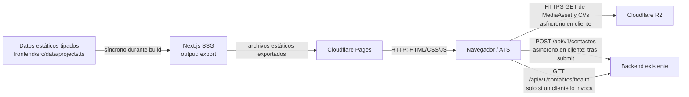

# Arquitectura del Sistema — Portafolio Bilingüe
- **Versión:** v0.1
- **Estado:** Borrador para revisión cruzada
- **Fecha:** 2026-11-19

## 1. Arquitectura general y flujo de datos

**Decisión.** El proceso de build de Next.js con `output: 'export'` genera las rutas estáticas `/` (Locale `es`) y `/en` (Locale `en`). Cloudflare Pages entrega esos archivos estáticos. El navegador carga los MediaAsset y PDFs de CV por HTTPS desde Cloudflare R2, y cuando el usuario envía el formulario, el cliente llama de forma asíncrona al Backend existente. El build no llama al Backend ni a R2 para enviar formularios.

**Por qué.** Esta distribución aplica los ADR aceptados, mantiene el HTML inicial disponible para ATS sin JavaScript y limita las interacciones de contacto a la ejecución del cliente.



Flujos:

- **Estáticos en build:** los datos versionados de proyectos se incorporan al HTML exportado. La generación de `/` y `/en` es local al build; no supone una llamada de red a Backend ni a Cloudflare R2.
- **Entrega estática:** Cloudflare Pages sirve la exportación de Next.js. El HTML debe incluir el perfil y las Ficha técnica en línea completas, visibles sin JavaScript.
- **Asíncronos en cliente:** el navegador obtiene medios y CV desde las URLs HTTPS configuradas en `frontend/src/config/media.ts`; el formulario de contacto envía un POST al Backend. Los estados de carga, éxito y error del formulario pertenecen al cliente.
- **Host final:** el usuario confirmó `albertozompantzi-portfolio.pages.dev` (URL esperada: `https://albertozompantzi-portfolio.pages.dev`).

## 2. Ownership por servicio/componente

**Decisión.** Cada responsabilidad de la tabla tiene un único componente dueño. Las comunicaciones entre componentes no transfieren su ownership.

**Por qué.** Esta asignación conserva fronteras explícitas entre contenido y renderizado, servicio de contacto, almacenamiento de medios y entrega web.

| Responsabilidad | Componente dueño |
|---|---|
| Datos tipados del catálogo y contenido bilingüe incorporados al build | Frontend SSG/Cliente |
| Generación de las rutas `/` y `/en`, HTML inicial, metadatos y ProgressiveEnhancement en el navegador | Frontend SSG/Cliente |
| `media.ts`: registro central de URLs de MediaAsset y textos `alt` por Locale; selección de CV por idioma | Frontend SSG/Cliente |
| Validación cliente, HoneypotField, estados localizados y llamada HTTP de contacto | Frontend SSG/Cliente |
| Recepción del DTO `ContactoDTO`, validaciones declaradas en DTO, guardado y respuesta de contacto | Backend existente |
| Persistencia de `Contacto` mediante repositorio existente | Backend existente |
| Almacenamiento y entrega HTTPS de MediaAsset sanitizados y PDFs de CV | Cloudflare R2 |
| Alojamiento y entrega de los archivos estáticos exportados | Cloudflare Pages |

**Qué NO hace cada componente**

- **Frontend SSG/Cliente:** no persiste contactos; no valida ni aplica CORS en el servidor; no sube activos a R2 durante la navegación; no incluye CMS ni base de datos nueva. HoneypotField no protege contra POST directo al endpoint.
- **Backend existente:** no sirve el sitio estático ni los medios/CVs; no define contenido del catálogo; no implementa rate-limiting (excluido); no se atribuye la validación del HoneypotField, que es solo cliente.
- **Cloudflare R2:** no genera HTML ni procesa formularios; no administra el catálogo ni transforma la respuesta del Backend.
- **Cloudflare Pages:** no ejecuta lógica de servidor de Next.js ni es el Backend de contacto; entrega los archivos estáticos exportados.

## 3. Endpoints externos

**Decisión.** El cliente usará `NEXT_PUBLIC_API_BASE_URL` como URL base del Backend y concatenará las rutas relativas documentadas abajo. El endpoint de creación recibe exactamente los campos de `ContactoDTO`. El host del Backend y el nombre del proyecto Pages aún no constan en los documentos revisados, por lo que las URLs absolutas permanecen PENDIENTE.

**Por qué.** Se utiliza el controlador existente en `backend/` sin añadir endpoints ni alterar su lógica. La variable elegida permite configurar la URL de runtime/build pública necesaria para que el navegador alcance el servicio; no es un secreto.

### `POST /api/v1/contactos`

- **URL absoluta:** `{NEXT_PUBLIC_API_BASE_URL}/api/v1/contactos` (host base PENDIENTE).
- **Headers de petición:** `Content-Type: application/json`. En petición de navegador cross-origin se envía `Origin: https://albertozompantzi-portfolio.pages.dev`.
- **CORS existente:** `ContactoController` declara `@CrossOrigin(origins = "*")`. No hay allowlist ni variable de entorno CORS en los archivos de configuración inspeccionados. El Origin real de producción y las cabeceras CORS observadas en despliegue quedan PENDIENTE.
- **Request JSON** (válido; `asunto` es opcional):

```json
{
  "nombre": "Alberto Zompantzi",
  "email": "alberto@example.com",
  "asunto": "Contacto profesional",
  "mensaje": "Me gustaría conversar sobre una oportunidad."
}
```

- **Éxito:** `201 Created`; el controlador devuelve la entidad `Contacto` guardada. Ejemplo con valores ilustrativos y formato de `LocalDateTime`:

```json
{
  "id": 1,
  "nombre": "Alberto Zompantzi",
  "email": "alberto@example.com",
  "asunto": "Contacto profesional",
  "mensaje": "Me gustaría conversar sobre una oportunidad.",
  "fechaRegistro": "2026-11-19T12:30:00"
}
```

- **Validaciones observadas:** `nombre` y `mensaje` tienen `@NotBlank`; `email` tiene `@NotBlank` y `@Email`; `asunto` no tiene anotación de validación. El formato exacto de respuesta HTTP 400 no está definido por código propio en los archivos inspeccionados y queda **PENDIENTE** de confirmar en runtime. No se encontró manejo de error global propio.
- **Otros estados:** respuestas de errores de persistencia/servidor PENDIENTE; el controlador no declara esos contratos.

### `GET /api/v1/contactos/health`

- **URL absoluta:** `{NEXT_PUBLIC_API_BASE_URL}/api/v1/contactos/health` (host base PENDIENTE).
- **Headers:** no requiere body; Origin se aplica desde navegador si es cross-origin. CORS está sujeto a la anotación actual descrita arriba.
- **Éxito:** `200 OK`, texto plano exacto `Servidor despierto y listo.`.
- **Response JSON:** no aplica; la respuesta es texto plano.

## 4. Contratos internos y fronteras

**Decisión.** Los datos estáticos se tipan y resuelven en build; el registro `media.ts` relaciona MediaAsset con URLs de R2; el cliente transforma el formulario en el JSON aceptado por `ContactoDTO`. Los esquemas siguientes reflejan los campos conceptuales del Glosario y los tipos observados en Backend. La forma definitiva del contenido de proyectos y la implementación de `visualFallback` siguen pendientes donde el Glosario las marca como propuesta.

**Por qué.** Los contratos hacen explícito qué cruza cada frontera, sin introducir CMS, una base de datos nueva ni capacidades no presentes.

### Datos estáticos → Build SSG

Esquema conceptual `Project` del Glosario: `slug`, `visibilityRule`, `repoUrl`, `liveUrl`, `stackTags`, `roleTags`, `mediaId`, `locales`. Cada Locale contiene `title`, `summary`, `problem`, `solution`, `stackDescription`, `roleDescription`, y los campos opcionales `architecture`, `flowOrDiagram`, `technicalChallenges`, `results`.

Ejemplo JSON válido con campos según el esquema conceptual; las taxonomías y regla de publicación aún están PENDIENTE:

```json
{
  "slug": "ejemplo",
  "visibilityRule": "PENDIENTE",
  "repoUrl": null,
  "liveUrl": null,
  "stackTags": [],
  "roleTags": [],
  "mediaId": null,
  "locales": {
    "es": {
      "title": "Ejemplo",
      "summary": "Resumen del proyecto.",
      "problem": "Problema descrito.",
      "solution": "Solución descrita.",
      "stackDescription": "Stack documentado.",
      "roleDescription": "Rol documentado.",
      "architecture": null,
      "flowOrDiagram": null,
      "technicalChallenges": null,
      "results": null
    },
    "en": {
      "title": "Example",
      "summary": "Project summary.",
      "problem": "Problem described.",
      "solution": "Solution described.",
      "stackDescription": "Documented stack.",
      "roleDescription": "Documented role.",
      "architecture": null,
      "flowOrDiagram": null,
      "technicalChallenges": null,
      "results": null
    }
  }
}
```

Este ejemplo ilustra estructura y no afirma un proyecto real ni valores aprobados. `PENDIENTE` es documentación y no debe renderizarse en UI.

### Frontend → Cloudflare R2 vía `media.ts`

El Glosario define conceptualmente `MediaAsset` con `id`, `url`, `alt` por Locale y `visualFallback`. Las URLs definitivas y la implementación de fallback siguen PENDIENTE.

```json
{
  "id": "profile",
  "url": "https://<bucket-publico-pendiente>.r2.dev/profile.webp",
  "alt": {
    "es": "Retrato de perfil",
    "en": "Profile portrait"
  },
  "visualFallback": null
}
```

URL ilustrativa no desplegable: el dominio público del bucket, las rutas y `visualFallback` deben concretarse en D-03/D-06. Navegación: el cliente realiza GET HTTPS al recurso; no existe aquí un endpoint de escritura/subida definido para el navegador.

### Frontend → Backend existente

Frontera `ContactSubmission`: `payload` contiene el DTO exacto; `honeypot` y `locale` son datos solo cliente y no se envían al Backend.

Esquema del payload HTTP según `ContactoDTO`:

```json
{
  "nombre": "Alberto Zompantzi",
  "email": "alberto@example.com",
  "asunto": "Contacto profesional",
  "mensaje": "Me gustaría conversar sobre una oportunidad."
}
```

La respuesta de éxito corresponde a la entidad `Contacto` descrita en la sección 3. El POST es asíncrono tras la acción del usuario. El backend no recibe `honeypot` ni `locale`.

### Puntos de coherencia de ownership

- Cloudflare Pages es dueño de entregar archivos estáticos; Frontend SSG/Cliente es dueño de generarlos.
- Cloudflare R2 es dueño del almacenamiento/entrega de objetos; Frontend SSG/Cliente es dueño del registro `media.ts` y de solicitar los objetos.
- Backend existente es dueño de validar el DTO declarado y persistir el contacto; Frontend SSG/Cliente es dueño de la validación de formato cliente, del HoneypotField y de presentar estados de interacción.

## 5. Respuesta canónica y reglas de campos derivados

**Decisión.** La fuente canónica del catálogo es `frontend/src/data/projects.ts`: cada `Project` contiene sus datos compartidos y `locales` con los contenidos `es` y `en` de `LocalizedProjectContent`. La fuente canónica de activos es `frontend/src/config/media.ts`, que registra cada `MediaAsset`. El estado del formulario es efímero y reside en el cliente; `ContactSubmission` mantiene `payload` con el DTO exacto descrito en la sección 3, además de `honeypot` y `locale` solo en cliente. No se duplican en estado persistido ni en copias derivadas los valores que puedan calcularse desde estas fuentes.

**Por qué.** Esta organización sigue los contratos conceptuales del Glosario, conserva el contenido bilingüe disponible para SSG y evita que datos derivados diverjan de la configuración canónica.

| Valor o comportamiento | Fuente canónica | Regla de derivación | Persistencia / duplicación |
|---|---|---|---|
| Contenido mostrado del proyecto | `Project.locales[Locale]` | Resolver el contenido por el `Locale` de la ruta (`/` → `es`, `/en` → `en`) durante build/renderizado. | No crear una copia por idioma fuera de `locales`. |
| Visibilidad de enlaces del proyecto | `visibilityRule`, `repoUrl`, `liveUrl` y matriz de D-04a/D-04b | Renderizar solo el enlace de repositorio confirmado como público y solo la URL de producción confirmada. Omitir producción cuando está PENDIENTE; para Automatización n8n no mostrar enlaces externos. La regla conceptual exacta sigue PENDIENTE en D-04a/D-04b. | No almacenar flags redundantes como “mostrar repositorio” o “mostrar producción”; calcular la presentación desde datos y decisión aprobada. |
| Texto alternativo de activo | `MediaAsset.alt` | Seleccionar `alt[Locale]` según ruta. | No duplicar el `alt` localizado en cada proyecto; referenciar el activo por `mediaId`. |
| Fallback visual | `MediaAsset.visualFallback` | Activar solo en cliente hidratado si falla la carga del activo, según HU-01. Implementación PENDIENTE. | No persistir el resultado del error ni duplicar el fallback en datos de proyecto. |
| PDF de CV | Registro de URLs en `media.ts` y Locale | Seleccionar el PDF ES para `es` y el PDF EN para `en`; las URLs y ubicación definitivas siguen PENDIENTE en D-06. | No guardar una selección de CV aparte del Locale activo. |
| Estado/valores del formulario | Campos del formulario y `ContactFormStatus` | Mantener valores y estado durante la interacción en memoria del cliente; reiniciar/limpiar según el resultado de envío definido por la implementación. | No guardar datos personales en `localStorage`, `sessionStorage`, cookies ni consola. No incluir `honeypot` o `locale` en el payload HTTP. |
| Modo del fondo | Capacidades del dispositivo, `prefers-reduced-motion` y errores del script | Tras `HYDRATED`, elegir `STATIC_TOUCH` si el dispositivo es táctil; si no, `STATIC_REDUCED_MOTION` cuando la preferencia es `reduce`; en escritorio sin esa preferencia elegir `INTERACTIVE_POINTER`. Si falla el script mientras está activo, pasar a `STATIC_FALLBACK`. | No persistir el modo: reevaluarlo en cada carga/hidratación. Umbrales de rendimiento PENDIENTE en D-07d. |

## 6. Máquina de estados

**Decisión.** Las transiciones válidas son las que aparecen en las siguientes tablas y en los tres recorridos correspondientes de [flows.md](flows.md): Recorrido A en el diagrama principal (sección 1), Recorrido B en la máquina del formulario (sección 2) y Recorrido C en el diagrama principal (sección 1). La secuencia de servicios de la sección 3 de `flows.md` complementa el efecto de red del formulario.

**Por qué.** Las tablas fijan guardas y efectos observables para implementar y revisar las mismas rutas descritas por los diagramas fuente, sin introducir estados nuevos.

### Recorrido A: Carga e hidratación de página

| Estado actual | Evento / Condición | Estado siguiente | Efecto observable |
|---|---|---|---|
| Inicial | Solicitud de `/` o `/en` recibe HTML prerenderizado | `SSR_STATIC` | HTML completo con idioma y contenido inicial; medios se solicitan aparte. |
| `SSR_STATIC` | JavaScript deshabilitado | `SSR_STATIC` (final válido) | Contenido estático íntegro permanece visible y legible. |
| `SSR_STATIC` | JavaScript activo; hidratación termina sin errores | `HYDRATED` | Interacciones de mejora progresiva quedan habilitadas; se habilita evaluación del fondo. |
| `SSR_STATIC` | JavaScript activo; ocurre error de hidratación | `HYDRATION_FAILED` | DOM inicial permanece íntegro y visible. |

### Recorrido B: Formulario de contacto

| Estado actual | Evento / Condición | Estado siguiente | Efecto observable |
|---|---|---|---|
| Inicial | Render inicial del formulario | `IDLE` | Formulario listo y nota de privacidad localizada visible. |
| `IDLE` | Evento `submit` | `VALIDATING` | Cliente revisa campos y `HoneypotField` antes de red. |
| `VALIDATING` | Honeypot contiene texto | `DROPPED_HONEYPOT` | Descarta silenciosamente; cero petición HTTP y ningún error mostrado. |
| `VALIDATING` | Campos obligatorios vacíos o correo inválido | `ERROR_VALIDATION` | Detiene envío y muestra error localizado; no inicia petición. |
| `VALIDATING` | Validación cliente correcta y honeypot vacío | `SUBMITTING` | Muestra carga localizada y envía el payload documentado a la URL de entorno. |
| `ERROR_VALIDATION` | Usuario corrige los valores y vuelve a enviar | `VALIDATING` | Revalida antes de cualquier petición. |
| `SUBMITTING` | Backend acepta el envío (respuesta exitosa y origen aceptado) | `SUCCESS` | Detiene carga y muestra confirmación localizada. |
| `SUBMITTING` | Error de red, rechazo CORS o respuesta HTTP de error | `ERROR_NETWORK` | Detiene carga y muestra error localizado. |
| `ERROR_NETWORK` | Usuario reintenta | `VALIDATING` | Revalida antes de volver a solicitar. |

### Recorrido C: Fondo reactivo

| Estado actual | Evento / Condición | Estado siguiente | Efecto observable |
|---|---|---|---|
| `HYDRATED` | Dispositivo táctil | `STATIC_TOUCH` | Sin elemento animado ni listeners de puntero. |
| `HYDRATED` | No táctil y `prefers-reduced-motion: reduce` | `STATIC_REDUCED_MOTION` | Sin elemento animado ni listeners de puntero. |
| `HYDRATED` | Escritorio no táctil, sin movimiento reducido y script sin error | `INTERACTIVE_POINTER` | Fondo sigue el puntero; solo se animan `transform`/`opacity`, con parámetros D-07d PENDIENTE. |
| `INTERACTIVE_POINTER` | Error al inicializar o actualizar el efecto | `STATIC_FALLBACK` | Limpia el efecto y listeners; interfaz queda estática. |

## 7. Enums cerrados (sin texto libre)

**Decisión.** Se permiten exclusivamente los valores siguientes, con la grafía exacta del Glosario. Los componentes que los originan son los responsables de emitir transiciones descritas en la sección 6.

**Por qué.** Un conjunto cerrado evita estados implícitos y mantiene la terminología del dominio alineada con GLOSSARY.md y flows.md.

| Enum | Valor permitido | Significado | Componente que lo origina |
|---|---|---|---|
| `Locale` | `es` | Español, ruta `/` y `x-default`. | Resolutor de ruta/SSG. |
| `Locale` | `en` | Inglés, ruta `/en`. | Resolutor de ruta/SSG. |
| `HydrationStatus` | `SSR_STATIC` | HTML prerenderizado disponible antes de JavaScript; estado válido si JS está deshabilitado. | SSG/entrega estática y cliente al inicio. |
| `HydrationStatus` | `HYDRATED` | Scripts cliente ejecutados sin errores; habilita interacciones y evaluación del fondo. | Frontend SSG/Cliente. |
| `HydrationStatus` | `HYDRATION_FAILED` | Falló JavaScript; DOM inicial sigue íntegro y visible. | Frontend SSG/Cliente al capturar fallo de hidratación. |
| `ContactFormStatus` | `IDLE` | Formulario inicial, nota de privacidad visible y listo. | Renderizado del formulario en Frontend SSG/Cliente. |
| `ContactFormStatus` | `VALIDATING` | Revisión cliente de formato y honeypot. | Componente del formulario al recibir `submit` o reintento. |
| `ContactFormStatus` | `DROPPED_HONEYPOT` | Descarte cliente sin HTTP. | Componente del formulario si honeypot contiene texto. |
| `ContactFormStatus` | `SUBMITTING` | Petición HTTP en curso, con espera de arranque en frío. | Componente del formulario tras validar. |
| `ContactFormStatus` | `SUCCESS` | Backend aceptó; confirmación localizada visible. | Componente del formulario tras respuesta exitosa. |
| `ContactFormStatus` | `ERROR_VALIDATION` | Campos requeridos vacíos o correo inválido antes de red. | Validador cliente del formulario. |
| `ContactFormStatus` | `ERROR_NETWORK` | Fallo de red, rechazo CORS o respuesta HTTP de error. | Componente del formulario al observar el fallo. |
| `BackgroundMode` | `INTERACTIVE_POINTER` | Seguimiento del cursor en escritorio, con `transform`/`opacity`; umbrales D-07d PENDIENTE. | Evaluador del fondo en cliente tras `HYDRATED`. |
| `BackgroundMode` | `STATIC_REDUCED_MOTION` | Fondo desactivado por `prefers-reduced-motion: reduce`, sin elemento animado ni listeners. | Evaluador del fondo en cliente. |
| `BackgroundMode` | `STATIC_TOUCH` | Fondo desactivado en dispositivo táctil, sin elemento animado ni listeners. | Evaluador del fondo en cliente. |
| `BackgroundMode` | `STATIC_FALLBACK` | Fondo desactivado tras error de inicialización o ejecución. | Controlador del fondo al capturar error. |

## 8. Reglas de negocio configurables

**Decisión.** Solo se configura mediante variables de entorno lo documentado en la tabla. La URL base existente es `NEXT_PUBLIC_API_BASE_URL`; el nombre de la variable de orígenes permitidos del backend permanece PENDIENTE, pues la sección 3 registra la configuración actual `@CrossOrigin(origins = "*")` sin variable localizada. Los umbrales de D-07c/D-07d se mantienen explícitamente pendientes junto con los supuestos del PRD.

**Por qué.** Se conserva la configuración ya documentada y se evita presentar como contrato existente una variable que no aparece en el backend inspeccionado.

| Parámetro | Nombre de variable | Componente | Valor por defecto / SUPUESTO | Exposición |
|---|---|---|---|---|
| URL base del endpoint de contacto (rutas de sección 3 concatenadas) | `NEXT_PUBLIC_API_BASE_URL` | Frontend SSG/Cliente | Sin valor por defecto confirmado; debe configurarse por entorno. | Público: requerido por el navegador, no es secreto. |
| Dominio/origen permitido para CORS | **PENDIENTE: nombre por confirmar** | Backend existente | **PENDIENTE:** sección 3 indica wildcard actual `@CrossOrigin(origins = "*")`; PRD requiere aceptar solo el dominio final de producción. No se presume valor por defecto. | Privado como configuración de servidor (el origen no es secreto); nunca se expone como secreto cliente. |
| Timeout de petición del formulario para ColdStart | Nombre de variable **PENDIENTE**; PRD solo exige timeout configurado en cliente HTTP | Frontend SSG/Cliente | **SUPUESTO:** `>= 35 s`, según PRD; valor operativo y variable no documentados. | Público si se incorpora al bundle cliente; no contiene secreto. |
| Umbral de peso por SVG de marquesina (D-07c) | Nombre de variable **PENDIENTE**; mecanismo de configuración también PENDIENTE | Frontend/build y puerta de aceptación | **PENDIENTE D-07c; SUPUESTO PRD:** `<= 15 KB` por archivo. | Público/no secreto; se aplica a archivos y verificación de build. |
| Parámetros del fondo reactivo (D-07d), incluidos umbrales de FPS/LCP y dispositivo de referencia | Nombre de variable **PENDIENTE**; mecanismo de configuración también PENDIENTE | Frontend SSG/Cliente | **PENDIENTE D-07d:** PRD no fija valores SUPUESTO para estos umbrales; solo exige `transform`/`opacity` acelerados por GPU y respuesta estable. | Público/no secreto si son parámetros cliente. |

## 9. Flujo del formulario de contacto e invariantes

**Decisión.** El formulario conserva el flujo `IDLE → VALIDATING → SUBMITTING → SUCCESS` o `ERROR_NETWORK`, con las rutas de descarte y validación de la sección 6. Antes de cualquier red, el cliente valida los campos obligatorios documentados (`nombre`, `email`, `mensaje`, sujetos a confirmación de D-05) y comprueba el honeypot. El payload HTTP contiene exclusivamente los campos de `ContactoDTO` enumerados en la sección 3; `honeypot` y `locale` permanecen solo en cliente.

**Por qué.** Estas invariantes cumplen los criterios de privacidad, anti-spam cliente y uso del contrato existente sin ampliar el payload.

Invariantes obligatorios:

- Si `honeypot` contiene texto, se transita a `DROPPED_HONEYPOT` sin petición HTTP saliente ni mensaje de error.
- La nota de privacidad de una línea permanece visible junto al formulario en `/` y `/en`, en el idioma activo, e indica que los datos se usan exclusivamente para responder el contacto.
- La validación de cliente ocurre antes de invocar red. No sustituye las validaciones del backend.
- Cero datos personales ingresados en el formulario se escriben en `console.*`, `localStorage`, `sessionStorage` o cookies.
- El idioma (`locale`) y el campo trampa no se envían al backend. No se agregan campos al payload de la sección 3.
- El endpoint se lee de `NEXT_PUBLIC_API_BASE_URL` y no se presenta como enlace visible en la UI.

| Respuesta / fallo observado por cliente | Interpretación documentada | Estado siguiente | Efecto en UI |
|---|---|---|---|
| `201 Created` | Creación aceptada por el controlador descrito en sección 3. | `SUCCESS` | Detiene carga y muestra confirmación localizada. |
| `400` | Error HTTP de cliente/validación; formato de respuesta PENDIENTE en backend. | `ERROR_NETWORK` | Detiene carga y muestra error localizado genérico; no asumir ni mostrar detalles de respuesta no documentados. |
| Otro `4xx` | Respuesta HTTP de error del backend; contrato concreto PENDIENTE. | `ERROR_NETWORK` | Detiene carga y muestra error localizado genérico. |
| Fallo de red, rechazo CORS o timeout | No se obtiene respuesta utilizable desde el navegador. | `ERROR_NETWORK` | Detiene carga y muestra error localizado genérico. |
| `5xx` u otra respuesta HTTP de error | Error de servidor no definido en el contrato inspeccionado. | `ERROR_NETWORK` | Detiene carga y muestra error localizado genérico. |

## Preguntas abiertas y puntos PENDIENTE

- **D-01:** verificar en el despliegue la URL canónica y el Origin configurado; dominio confirmado: `https://albertozompantzi-portfolio.pages.dev`.
- **Backend:** host base de despliegue que se configurará en `NEXT_PUBLIC_API_BASE_URL`.
- **CORS:** confirmar en runtime las cabeceras y el comportamiento del Origin final; el código declara wildcard mediante `@CrossOrigin(origins = "*")`.
- **Backend:** formato HTTP 400 de validación y respuestas de error de persistencia/servidor, no fijados por un manejador propio localizado.
- **D-03/D-06:** dominio público y rutas finales de Cloudflare R2, disponibilidad HTTP 200, contenido sanitizado y PDFs finales.
- **Glosario / datos:** taxonomías de `stackTags` y `roleTags`, `visibilityRule` definitivo y configuración de `visualFallback`.

## 10. Modelo de datos mínimo

**Decisión.** El modelo de contenido persistido consiste únicamente en módulos TypeScript estáticos versionados dentro de `frontend/`. `frontend/src/data/projects.ts` mantiene el catálogo de proyectos con campos compartidos y contenido localizado `es`/`en`, conforme al contrato conceptual de `Project` y `LocalizedProjectContent` descrito en las secciones 4 y 5. `frontend/src/config/media.ts` es el catálogo central de `MediaAsset`, con identificador, URL externa, textos alternativos por Locale y referencia de fallback visual. Perfil, experiencia, formación, etiquetas y textos de interfaz se mantienen como datos/configuración estática tipada en el frontend; sus ubicaciones concretas siguen la organización del frontend sin añadir un almacén de datos.

No existe base de datos propia del portafolio ni persistencia de envíos en frontend. El formulario conserva sus valores y estado solo en memoria durante la interacción y envía al Backend existente el DTO documentado en sección 3. No se guardan datos personales en almacenamiento del navegador. En build se derivan las rutas `/` y `/en`, HTML, metadatos SEO, textos según Locale y enlaces de descarga según idioma. En cliente/runtime se derivan el estado del formulario, la selección de contenido por ruta, filtros y presentación interactiva, `alt` por Locale, modo del fondo reactivo y fallbacks ante error de carga. Estos derivados no son fuentes canónicas ni se persisten.

**Por qué.** Los módulos tipados constituyen una fuente revisable en Git y alimentan la exportación estática bilingüe del ADR-0002. Mantener efímero el formulario satisface los requisitos de privacidad y evita introducir un CMS, una base de datos o almacenamiento adicional.

## 11. Almacenamiento externo y convención de claves

**Decisión.** Cloudflare R2 se utiliza como bucket público de solo lectura para capturas sanitizadas y PDFs de CV, según ADR-0003. Las rutas siguientes son convenciones recomendadas dentro de un único bucket; el nombre del bucket, dominio público y URLs finales siguen PENDIENTE en D-03/D-06 hasta la subida y verificación:

| Uso | Clave recomendada | Content-Type |
|---|---|---|
| Captura sanitizada de proyecto | `projects/<slug>/<asset-id>.<version>.<ext>` | `image/webp` o `image/png`, según formato real |
| CV español | `cv/es/<nombre>.<version>.pdf` | `application/pdf` |
| CV inglés | `cv/en/<nombre>.<version>.pdf` | `application/pdf` |

Las capturas deben estar sanitizadas antes de subirlas (D-03); los originales crudos permanecen fuera de Git y no se publican. `media.ts` registra las URLs públicas HTTPS verificadas, los textos `alt` ES/EN y la referencia al fallback visual. Las rutas con versión permiten cacheo de larga duración e inmutable (por ejemplo, `Cache-Control: public, max-age=31536000, immutable`) cuando el objeto es inmutable; una actualización se publica bajo una clave nueva y se cambia la URL en `media.ts`. No se recomienda cacheo inmutable para claves que se sobrescriban. Se exige servir el tipo MIME correcto; no se deduce el Content-Type de la extensión únicamente. Las URLs de producción y confirmación HTTP 200 son PENDIENTE hasta cerrar D-03/D-06.

MediaPolicy exige cero binarios no exentos en Git y cero archivos en `frontend/public/imagenes/`; los medios se solicitan desde R2 y los únicos binarios exentos son los expresamente permitidos por dicha política. La Puerta de Aceptación HU-10 comprueba `git ls-files` y `git log` contra esta política.

**Por qué.** R2 permite servir medios sin acoplarlos al build ni inflar el historial del monorepo. Las claves versionadas hacen coherente el cacheo de objetos públicos con la actualización controlada de sus referencias.

## 12. Manejo de errores, timeouts, reintentos y fallbacks

**Decisión.** Los fallos de red no deben ocultar el contenido HTML estático. El formulario usa el timeout cliente requerido por PRD de al menos 35 s (`SUPUESTO` documentado en PRD) para tolerar el arranque en frío. No se reintenta automáticamente un POST: el usuario inicia el reintento desde el estado localizado de error, evitando duplicar contactos si el servidor guardó el envío pero se perdió la respuesta.

| Escenario de fallo | Detección | Timeout / Reintentos | Fallback garantizado |
|---|---|---|---|
| Cold start o caída de `backend/` | El POST no completa antes del timeout, falla la red o devuelve HTTP de error. | Timeout cliente `>= 35 s` (`SUPUESTO` del PRD). Sin reintento automático; el usuario puede reintentar. | Termina el estado de carga, muestra error localizado y conserva la página y el HTML estático. La caída del Backend no afecta perfil, catálogo ni CV enlazados. |
| Rechazo CORS | El navegador impide que JavaScript lea la respuesta; se observa como fallo de red en cliente. No siempre permite distinguirlo de otros fallos de red. | Se aplica el timeout del POST; no hay reintento automático. Reintento manual tras corregir el origen en backend/configuración. | Estado `ERROR_NETWORK` y mensaje localizado genérico; el contenido y los enlaces estáticos permanecen disponibles. |
| Error HTTP/red al cargar imagen R2 | Evento `error` del recurso o fallo HTTP observado por navegador. | No se bloquea el renderizado esperando la imagen. No se define reintento de descarga en aplicación. | El HTML conserva texto y `alt`; con cliente hidratado se activa el `visualFallback` configurado. Si no hay fallback disponible, el contenido textual permanece legible y no se oculta la ficha. |
| `HYDRATION_FAILED` | Excepción de hidratación JavaScript tras recibir HTML estático. | Sin reintento automático de hidratación. | DOM inicial íntegro y visible; filtros/modal y otras mejoras cliente pueden no estar disponibles. El recorrido estático con detalle en línea sigue legible. |
| Excepción del fondo reactivo → `STATIC_FALLBACK` | Error al inicializar o actualizar el efecto. | Sin reintento; se detiene el efecto y se limpian sus listeners. | Fondo estático, sin elemento animado ni listeners de puntero activos; contenido y navegación permanecen íntegros. |

**Por qué.** La estrategia conserva los invariantes de disponibilidad del PRD, no oculta fallos de contacto y evita que dependencias opcionales de cliente se conviertan en condición para leer el portafolio.

## 13. Responsabilidades por componente y orden de construcción

**Decisión.** La construcción sigue el Walking Skeleton del ROADMAP: primero monorepo y medios, luego exportación bilingüe mínima con Tzompcomer, integración de contacto, despliegue de humo, expansión y Puerta de Aceptación HU-10 antes de cada merge a `main`.

| Componente | Stack / Herramientas | Entregables técnicos | Restricciones |
|---|---|---|---|
| Frontend SSG/Cliente | Next.js, TypeScript, React; `output: 'export'` | Rutas `/` (ES) y `/en` (EN); HTML prerenderizado con contenido y fichas en línea; módulos tipados de contenido; navegación entre idiomas; mejora progresiva; formulario conectado al Backend; selección de CV; manejo de fallos. | Sin servidor SSR dinámico ni APIs de servidor Next.js; sin CMS ni persistencia propia. HTML y fichas deben seguir legibles sin JavaScript. |
| Backend existente | Servicio y herramientas ya presentes en `backend/` | Recibir el DTO de contacto, validarlo y persistirlo según el contrato existente; permitir la configuración CORS necesaria para el origen desplegado. | No modificar lógica de negocio ni añadir rate-limiting para el MVP; no servir el frontend ni medios. |
| Cloudflare R2 | Bucket público con acceso HTTPS de lectura | Capturas sanitizadas y PDFs ES/EN con Content-Type correcto; URLs verificadas referenciadas desde `media.ts`. | No subir originales crudos ni binarios no exentos a Git; URLs finales PENDIENTE en D-03/D-06. |
| Cloudflare Pages | Hosting estático | Publicar la exportación de Next.js y el preview del Walking Skeleton. | No ejecutar lógica de servidor Next.js ni asumir rol de Backend. |
| Repositorio / Puerta HU-10 | Git y verificaciones de aceptación del PRD | Auditar HTML sin JS, CVs, URLs, enlaces, CORS/formulario, privacidad y ausencia de binarios no exentos antes de cada merge a `main`. | Monorepo con `frontend/`, `backend/`, `docs/`; excluir `Información faltante/` y cumplir MediaPolicy. |

Orden: 1) inicialización y exclusión de medios crudos; 2) rutas estáticas bilingües, perfil, CV y detalle en línea de Tzompcomer; 3) formulario contra Backend existente; 4) despliegue de humo y validación con/sin JavaScript; 5) expansión al resto de proyectos cuando las confirmaciones D-04a/D-04b lo permitan; 6) ejecución integral de HU-10 para cada merge. El alcance visual Should se integra después de los Must según dependencias del ROADMAP.

**Por qué.** La secuencia establece una entrega comprobable temprana con Tzompcomer, limita el acoplamiento entre despliegues y hace que HU-10 funcione como puerta técnica repetible de calidad y privacidad.

## 14. Contrato mínimo de errores HTTP

**Decisión.** La capa de presentación clasifica el resultado HTTP y muestra mensajes ES/EN; no expone el cuerpo de error del Backend como texto de interfaz. El contrato observado para éxito es `201 Created` con la entidad `Contacto`. Para errores, los documentos y el código inspeccionado no definen una estructura JSON propia uniforme del Backend. Por ello, la capa cliente normaliza los errores a esta estructura interna (no es un contrato de respuesta que se atribuya al Backend):

```json
{
  "code": "HTTP_ERROR",
  "status": 400,
  "messageKey": "contact.error.generic"
}
```

`code` es uno de `HTTP_ERROR`, `NETWORK_ERROR`, `TIMEOUT` o `CORS_OR_NETWORK_ERROR`; `status` es el estado HTTP cuando existe respuesta y `null` cuando no existe; `messageKey` selecciona una cadena controlada y localizada del frontend. Ejemplo con fallo de red, JSON válido:

```json
{
  "code": "NETWORK_ERROR",
  "status": null,
  "messageKey": "contact.error.generic"
}
```

| Respuesta observada | Clasificación de presentación | Acción ES/EN |
|---|---|---|
| 2xx (el endpoint documentado responde `201`) | Éxito; detener carga | Confirmación localizada y estado `SUCCESS`. No exigir parsear un cuerpo de error. |
| 400 | `HTTP_ERROR`, estado 400 | Error localizado genérico; no asumir esquema de validación del Backend. |
| 403 o rechazo CORS | Si se recibe HTTP 403, `HTTP_ERROR`; si el navegador bloquea CORS, `CORS_OR_NETWORK_ERROR` sin estado legible | Error localizado genérico. |
| 429, si aplica y si el servidor lo devuelve | `HTTP_ERROR`, estado 429 | Error localizado genérico; no se presupone que Backend implemente rate-limiting ni que emita este código. |
| 5xx | `HTTP_ERROR`, estado recibido | Error localizado genérico y reintento manual disponible. |
| Error de red o timeout | `NETWORK_ERROR` o `TIMEOUT`, sin estado | Error localizado genérico y reintento manual disponible. |

**Por qué.** La normalización ofrece una interfaz estable a la presentación bilingüe y mantiene separado lo que el frontend puede garantizar de las respuestas de error que el Backend todavía no documenta.

## 15. Alcance y exclusiones del MVP

**Decisión.** La arquitectura MVP incluye un monorepo con frontend estático bilingüe exportado por Next.js y alojado en Cloudflare Pages, contenido tipado y versionado, catálogo de medios R2, CV ES/EN, mejora progresiva de la interfaz, formulario cliente conectado al Backend existente y verificación mediante HU-10.

Quedan explícitamente excluidos (Won't):

- CMS, panel administrativo o base de datos propia para contenido o proyectos.
- Persistencia de envíos en frontend.
- Rate-limiting nuevo o cambios a la lógica de negocio del Backend.
- Publicación del archivo `.json` de Automatización n8n o enlaces externos a ese contenido.
- Servidor SSR dinámico, API Routes, middleware dinámico o funciones de servidor de Next.js.
- Analítica de comportamiento, CAPTCHA de terceros y rediseño interno de PDFs, conforme a PRD.

**Por qué.** El recorte mantiene el MVP alineado con los ADR aceptados, prioriza disponibilidad estática y evita ampliar el alcance con servicios o procesos no requeridos para el portafolio.


