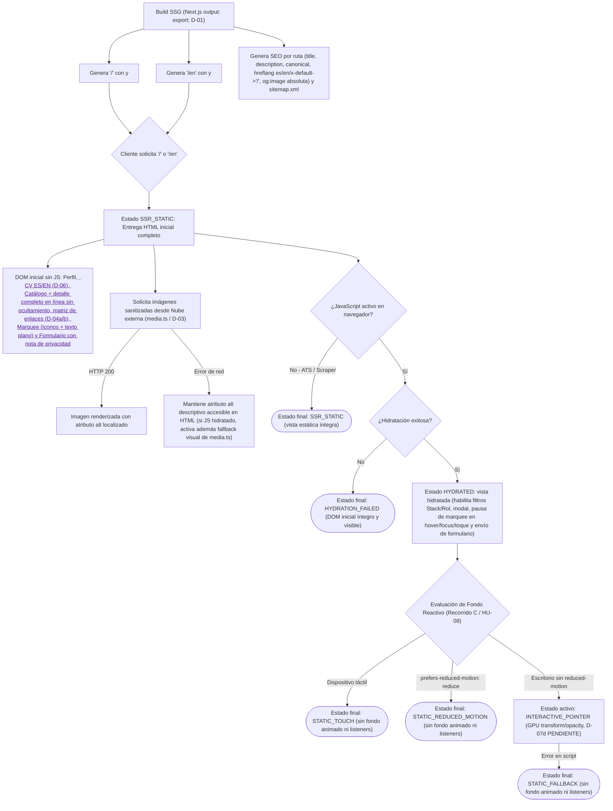
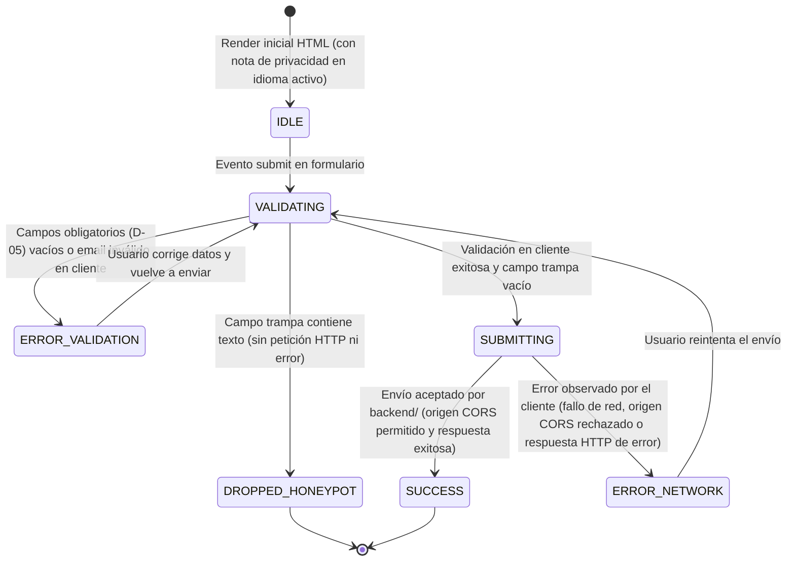
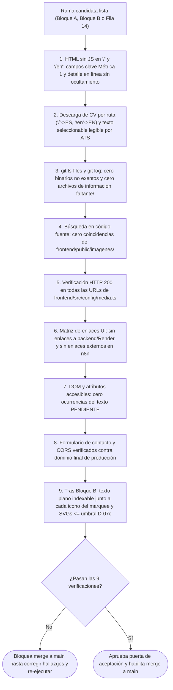

# Diagramas de Flujo y Estados del Sistema

> **Fuentes:** `docs/product/BRIEF.md` (v1.7), `docs/product/ROADMAP.md` (v1.4), `docs/product/PRD.md` (v1.2) y `docs/product/GLOSSARY.md`.  
> **Nota:** Las decisiones aún marcadas como `PENDIENTE` (`D-03`, `D-04a`/`D-04b`, `D-05`, `D-06`, `D-07a`–`D-07d`) se representan como interfaces abstractas hasta cerrarse en los Pasos 7 y 8. D-01 está cerrado; ADR-0002 define Next.js con exportación estática en Cloudflare Pages y el dominio de producción.

---

## 1. Flujo Principal de Compilación, Entrega Estática, Hidratación y Fondo (`flowchart`)



---

## 2. Máquina de Estados del Formulario de Contacto (`stateDiagram-v2`)



---

## 3. Secuencia de Interacción entre Servicios (`sequenceDiagram`)

```mermaid
sequenceDiagram
    actor U as Usuario / Reclutador / ATS
    participant H as Hosting Estático (SSG / D-01)
    participant C as Nube de Medios (D-03)
    participant B as Backend Existente (D-05)

    U->>H: GET / o GET /en
    H-->>U: HTML prerenderizado completo (perfil, <a href> CV, catálogo con detalle en línea y enlaces D-04a/b, marquee con texto plano, SEO/hreflang y formulario)
    U->>C: GET activos gráficos (URLs desde media.ts)
    alt Activo disponible (HTTP 200)
        C-->>U: Imagen sanitizada
    else Error de carga en nube
        C-->>U: Error HTTP / Timeout
        Note over U: Atributo alt accesible en HTML (si JS hidratado, activa fallback visual de media.ts)
    end

    opt Usuario envía formulario de contacto (requiere ejecución de script en cliente; sin JS el formulario no envía)
        Note over U: Validación de formato en cliente + revisión de campo trampa vacío
        U->>B: POST <ENDPOINT_ENV> (payload según D-05 PENDIENTE, Origin: dominio final)
        alt Envío aceptado por backend/ (origen CORS permitido y respuesta exitosa)
            B-->>U: Respuesta exitosa (mensaje de confirmación localizado ES/EN)
        else Error observado por el cliente (fallo de red, rechazo CORS o respuesta HTTP de error)
            Note over U: Fallo de red, rechazo CORS en navegador o respuesta HTTP de error
            Note over U: Detiene estado de carga y muestra error localizado ES/EN
        end
    end
```

---

## 4. Puerta de Aceptación Técnica Previa a Merge a `main` (`HU-10` / Fila 8)


